# Cracked Dev Roadmap

Source export: 2026-09-22 · @Someone

Beginner revision. The original phase order and project-first approach are retained. Short bridges explain prerequisites at the point of use. Corrections are integrated into the text; see `ROADMAP-REVIEW.md` for the main changes and verification limits.

## How to use this roadmap

This is a long-term path from beginner C to someone who can build a small kernel, GPU matmul, bytecode VM and storage engine, and explain why each is fast or slow. There are thirteen numbered phases after setup, plus the C crash course and game-dev track. Each phase has a primary resource and a project. You are done when the core project passes its tests and you can explain it, not when you finish the reading.

### The stance

The roadmap is opinionated on purpose. It follows the school of Casey Muratori, Jonathan Blow, Mike Acton, Andrew Kelley, Ryan Fleury and Chris Wellons more than it follows the C++ committee or the "modern" idioms crowd. Concretely:

- **The machine is the ground truth.** Every abstraction gets judged by what instructions it emits and what memory it touches. You learn hardware before you learn language features.
- **C first, then everything else.** C is small enough to hold in your head and close enough to the metal that nothing hides. Rust, C++, Zig, Lua and CUDA all make more sense once you know what they compile down to.
- **Data before code.** The shape of your data in memory decides performance. Object-oriented modeling is deliberately absent. Data-oriented design is a whole phase.
- **Build, then read.** Each phase starts with a project. The book is there to unblock you, not to be read cover to cover before you type anything.
- **One source per topic.** Where two resources cover the same ground I picked one and said why. The appendix lists what I left out.
- **Not trendy.** No frameworks, no build-tool zoo, no "modern C++" feature tour. If a topic is here it is because it will still be true in 2040.

### The shape of the path

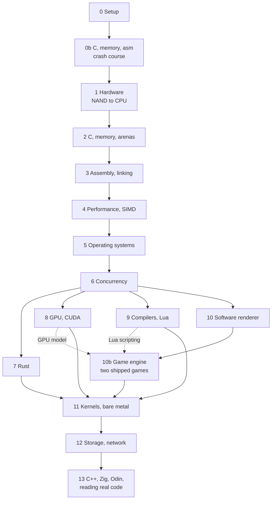

Phases 1 to 6 are strictly sequential. Each one uses what the one before built. Phases 7 to 10 branch: do them in the order listed, but you can swap 8 and 9 if the GPU work is more urgent for your ML background. Phase 10b follows 10 directly and is the game-dev track. It uses the Lua embedding from phase 9 and the GPU model from phase 8. Phases 11 to 13 close the loop.

### Phase map

| Phase | Topic | Primary resource | Full-track project (scope below) | Weeks at 12 h/week |
| --- | --- | --- | --- | --- |
| 0 | Mindset, tools, machine setup | this doc | working C, asm and Linux VM toolchain on your Mac | 1 |
| 0b | C, memory and assembly crash course | CS50x weeks 1 to 5, Python Tutor for C, Beej's Guide to C | a linked list, a growable array and a word counter in C, clean under sanitizers | 3 |
| 1 | How a computer works, gates to CPU | Nand2Tetris part 1 | the Hack CPU in HDL plus an assembler | 6 |
| 2 | C properly, memory, UB, arenas | Modern C plus CS:APP ch. 2 | an arena-based string and dynamic array library, a JSON parser on top of it | 8 |
| 3 | Machine level, asm 101 on ARM64 and x86-64, linking | Smith's ARM64 book, CS:APP ch. 3 and 7, Computer Enhance part 1 | hand-written ARM64 and x86-64 programs, then an 8086 instruction decoder and simulator | 8 |
| 4 | Memory hierarchy, performance, DOD, SIMD | Computer Enhance parts 2 to 4, Algorithmica, MIT 6.172 | haversine pipeline from 10 s to under 100 ms, then a SIMD hash table | 10 |
| 5 | Operating systems | OSTEP plus MIT 6.1810 xv6 labs | all xv6 labs, then your own shell, malloc and epoll or kqueue event loop | 12 |
| 6 | Concurrency and parallelism | Rust Atomics and Locks, CS149 | a work-stealing job system in C with a correct memory model | 6 |
| 7 | Rust | TRPL, Too Many Linked Lists, Rust for Rustaceans | port the phase 5 event loop and phase 4 hash table to Rust, benchmark both | 8 |
| 8 | GPU programming | PMPP 4e, GPU MODE, Simon Boehm matmul | CUDA matmul from naive to tensor cores, then a fused softmax and attention kernel | 10 |
| 9 | Compilers, interpreters, Lua | Crafting Interpreters part 3, Lua source | clox in C, then embed Lua into a C program and read the Lua VM | 10 |
| 10 | Graphics and real time, the handmade way | Handmade Hero first 60 episodes, Ray Tracing in One Weekend | a software rasterizer with a platform layer on SDL3, no engine | 10 |
| 10b | Game engines and game dev | Game Programming Patterns, Game Engine Architecture, SDL3 GPU, Fix Your Timestep | a small engine and two shipped games (2D, then 3D) with Lua scripting and debug tools | 10 |
| 11 | Kernels and bare metal | Writing an OS in Rust, OSDev wiki, RP2350 datasheet | a bootable kernel on QEMU with paging, interrupts and a scheduler, plus a bare-metal Pico program | 12 |
| 12 | Storage and network internals | CMU 15-445, Beej, SQLite source | a KV store with a write-ahead log and B+ tree, then a userspace TCP over a TUN device | 8 |
| 13 | C++ the sane way, Zig, Odin, reading real code | Handmade Hero style C++, TigerBeetle, SQLite, Lua, Redis | contribute a fix to one of those codebases | ongoing |

The listed phases total 122 weeks before the ongoing phase 13, or 1,464 hours at 12 hours a week. The same hours at 20 hours a week are about 17 months, before breaks and rework. These are planning estimates, not beginner deadlines. Some capstones can take much longer. Do not compress phases 2, 4 and 5 to stay on a calendar.

### Core work, stretch work, and when to move on

Keep the projects. Reduce the number of new problems you solve at once. The week tables describe the full track, not a promise that every beginner finishes every row in twelve hours.

| Phase | First working checkpoint | Stretch work after that checkpoint |
| --- | --- | --- |
| 0 to 3 | Compile and debug C; pass the listed core chip, parser and assembly tests | Extra exercises, Hack emulator, hand-written assembly speedups |
| 4 | Correct pipeline, repeatable measurements, one explained improvement | The 100x, 100 ms, 3x and peak-FLOPS targets |
| 5 | Selected xv6 labs, basic shell, tested allocator, bounded nonblocking server | Full job control, allocator interposition into Python, 10k connections |
| 6 | Tested job system using locks; bounded SPSC queue | Lock-free MPMC and weak-memory work-stealing deques |
| 7 | Safe Rust hash table and event-loop ports with comparisons | Generic unsafe arena and lock-free job-system port |
| 8 | Verified reduction and tiled matmul, profiled on your GPU | Tensor-core tuning, attention, Triton and Metal ports |
| 9 | Working clox and a small protected Lua host | Server hot reload, coroutines or register-VM redesign |
| 10 | Scalar rasterizer, debugger-friendly platform layer, playable build | Hot code reload, 1080p60 software rendering, extra ray-tracing books |
| 10b | Ship the small 2D game, then a tightly scoped 3D game | 100k sprites, general character physics, extra render passes |
| 11 | Boot, interrupts, mapped memory, two tasks; separate Pico exercise | Disk/filesystem, Linux modules, user mode and ELF loader |
| 12 | Single-writer recoverable KV store; isolated TCP handshake and echo | Group commit, broad TCP recovery/congestion testing, HTTP integration |

The chapter checklists retain the full-track goals. A stretch item is not a blocker for the next phase. If a later project needs a deferred component, use the simpler working version until you build it. For example, rendering can use a locked job queue; a game can use a small Lua host rather than the HTTP integration.

For each project, keep a short README with: how to build, how to test, the supported inputs, ownership rules, and known limits. Commit a working checkpoint before a large change. Keep a regression test for every bug you fix: it should fail before the fix and pass afterward.

**Use additions on demand.** A link in a beginner bridge answers one specific question. It is not another course to finish. If you can pass the small checkpoint already, skip the bridge. Hardware-dependent speed ratios are experiments, not grades.

### Weekly rhythm

- 60% of the time on the project, in the editor, with a debugger open.
- 25% reading the chapter you are stuck on, not the next chapter.
- 15% watching the one or two talks listed for the phase, once, with notes.
- Every Sunday, write 200 words on what you built and what confused you. This log is the only note-taking you need.

### How I taught the concepts here

Each phase has a "what you are actually learning" section with a diagram and a short explanation from me. They are not a replacement for the book. They give you the mental picture so the book reads faster.

### Using your Computer Enhance subscription

Casey Muratori's Computer Enhance course on Substack is part of this roadmap, not an extra. It assumes you can read C, so start it seriously after phase 0b. Follow it at the pace of the phases and don't binge ahead. Each part lands where you have the skills to do its homework.

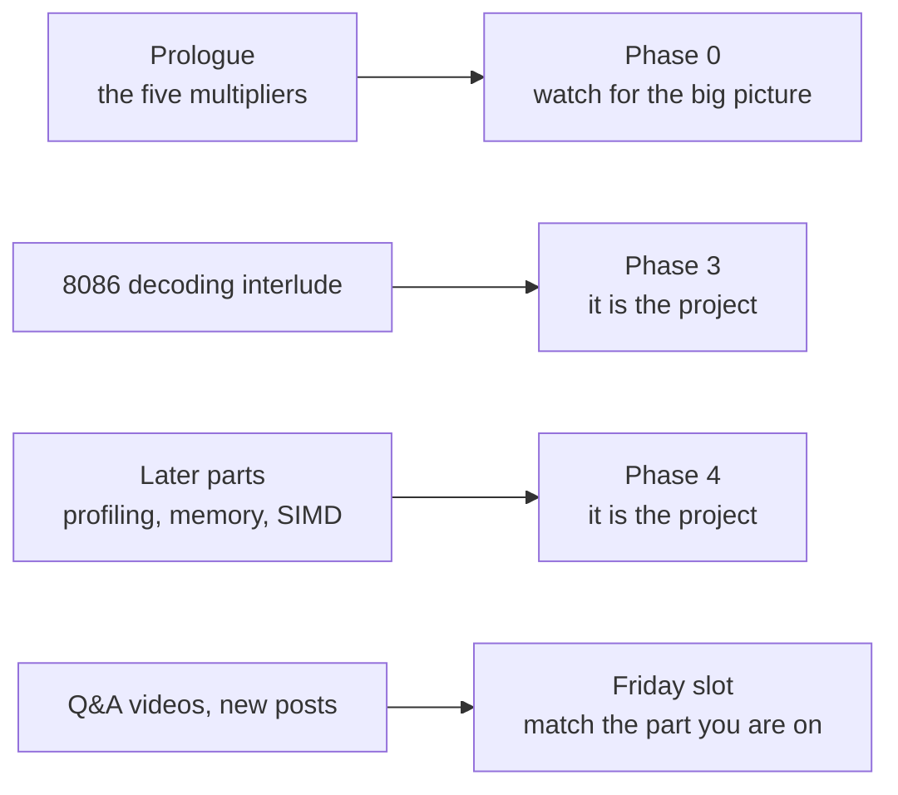

| Course material | When | How to use it |
| --- | --- | --- |
| Prologue | Phase 0 | Watch it for the big picture of why software is slow. Skip its exercises until after phase 3. |
| 8086 decoding and simulation interlude | Phase 3, weeks 3 to 5 | Do every homework listing. It is the phase 3 project. |
| Later parts: profiling, memory, SIMD | Phase 4 | Build every tool Casey builds, on your own haversine code. It is the phase 4 project. |
| Q&A videos and new posts | Any week, in the Friday slot | Watch the ones about the part you are on. Bookmark the rest for later. |

His free material fits in too: Handmade Hero is the phase 10 spine, and his talk "Simple Code, High Performance" is on the rewatch list in phase 13.

## The ecosystem, from a bird's-eye view

This map shows the big areas this roadmap covers and the main names in each. When you run into a name you don't know, find it here, go deep in the phase that covers it, then come back to the map.

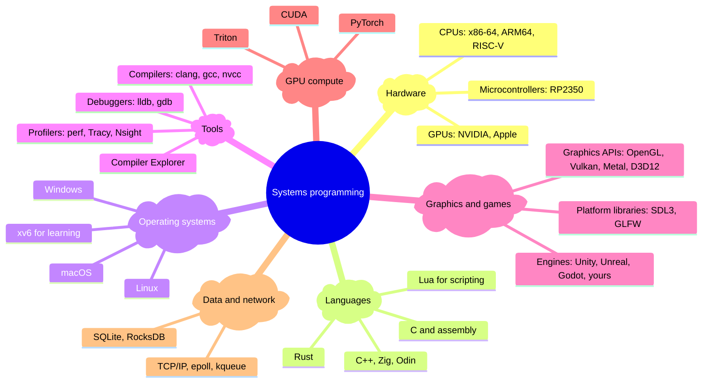

### Library, framework, engine, API

These four words cover most of the names above:

- **Library:** code you call. You stay in control. SDL3, miniaudio, Box2D and SQLite are libraries.
- **Framework:** code that calls you. You fill in the parts it asks for. PyTorch and Tokio are frameworks.
- **Engine:** a framework plus an editor, an asset pipeline and a renderer. Unity, Unreal and Godot are engines.
- **API (as in "graphics API"):** a specification that a GPU driver implements. OpenGL, Vulkan, Metal and Direct3D are APIs. You call them through the driver, and each vendor ships its own implementation.

### How the graphics stack fits together

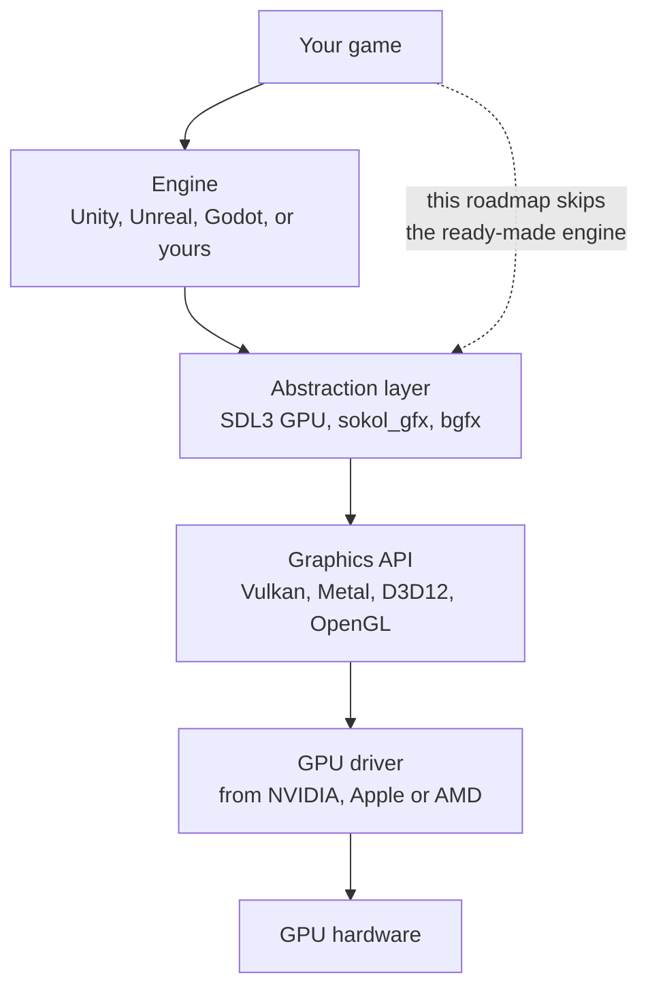

Each layer hides the one below it. Your Mac speaks Metal. Your NVIDIA laptop speaks Vulkan, Direct3D 12 and OpenGL. An abstraction layer like SDL3 GPU lets one renderer run on both machines.

### Names you will run into

| Name | Kind | What it does | Runs on | Phase |
| --- | --- | --- | --- | --- |
| OpenGL | graphics API | Older, simpler API for drawing triangles with shaders. The driver does a lot of work for you | Linux, Windows. macOS stops at 4.1 and marks it deprecated | 10 |
| Vulkan | graphics API | Modern low-level API. You manage GPU memory and synchronization yourself, so it is verbose | Linux, Windows, Android. macOS through MoltenVK | 10b, through SDL3 GPU |
| Metal | graphics and compute API | Apple's modern API | macOS, iOS | 8, 10b |
| Direct3D 12 | graphics API | Microsoft's modern API, similar to Vulkan | Windows, Xbox | 10b |
| SDL3 | platform library | Window, input, audio and timing on every OS | everywhere | 10, 10b |
| SDL3 GPU | abstraction library | One API over Vulkan, Metal and Direct3D 12 | everywhere | 10b |
| CUDA | compute platform | NVIDIA's C++ dialect and toolkit for general programs on the GPU | NVIDIA GPUs | 8 |
| Triton | compute language | GPU kernels written in Python at the tile level | NVIDIA and AMD GPUs | 8 |
| PyTorch | ML framework | Tensors and autograd. Calls CUDA kernels underneath | everywhere | 8, as the reference you test against |
| Unity, Unreal, Godot | game engines | Editor, renderer, physics and scripting in one package | everywhere | after 10b |
| Box2D | physics library | 2D rigid bodies and collisions | everywhere | 10b |
| Dear ImGui | UI library | Quick debug and tool UI, redrawn every frame | everywhere | 10b |
| Tracy | profiler | Frame-by-frame timing of every system | everywhere | 10b |
| clang / LLVM | compiler | Turns C, C++ and Rust into machine code | everywhere | 0 onward |
| QEMU | emulator | Runs a whole virtual machine, including other CPU types | everywhere | 5, 11 |
| xv6 | teaching OS | A small Unix written in C by MIT | QEMU | 5 |
| Lua | scripting language | A small language you embed in C programs | anywhere C runs | 9, 10b |
| SQLite | embedded database | A database as a library, with no server | everywhere | 12 |

## Phase 0: mindset, learning method, machine setup (1 week)

Goal: by the end of the week your tools are installed, you can compile and run a hello world in C on the Mac and in a Linux VM, and you know how to learn from this roadmap. Nothing here assumes you know C yet. The debugger comes at the end of phase 0b, once you can write programs worth stepping through.

**Builds on:** nothing. **Adds:** a working toolchain and the learning loop below.

### The learning method that fits you

You said you learn by doing and by pictures. The whole roadmap is built on one loop:

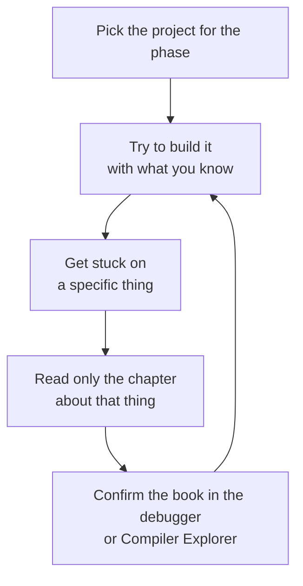

The last step is the one people skip. Do not believe a claim about memory, caches or the compiler until you have seen it in a debugger, a disassembly or a benchmark. That habit is what separates people who "know about" systems from people who can do systems.

Three rules that come from the people this roadmap follows:

1. **Write the straightforward version first.** Casey Muratori calls the alternative "pessimization": adding layers, indirections and abstractions the problem never asked for. Plain code that does the obvious thing is usually fast enough and always easier to make faster.
2. **Compress later, not earlier.** Write the code inline. When you see the same shape a third time, pull it out. Muratori calls this semantic compression. It is the opposite of designing class hierarchies up front.
3. **Know what the hardware is doing.** Mike Acton's line: "the purpose of all programs, and all parts of those programs, is to transform data from one form to another." If you cannot say what data a function reads and writes, you do not understand it yet.

### Your machine: Apple Silicon Mac

This matters more than it sounds. Your Mac is ARM64, most systems material is x86-64 and Linux, and there is no CUDA on macOS. Here is the setup that keeps you from fighting your machine for two years. Install the first two rows this week. The other rows belong to later phases and are listed here so you only set up once:

| Need | Use | Why |
| --- | --- | --- |
| C compiler and debugger | Xcode Command Line Tools (`clang`, `lldb`) | native, fast, sanitizers included |
| Linux APIs and labs | ARM64 Linux VM with OrbStack or Lima; QEMU for guest kernels | Linux supplies `strace`, `epoll` and ELF tools. VM performance counters may be unavailable |
| x86-64 assembly | explicitly configured x86-64 emulation, or native x86 laptop; Compiler Explorer for inspection | Emulation is for functional exercises. Measure x86 performance on native x86 hardware |
| GPU | your NVIDIA gaming laptop for CUDA (native Linux or WSL2); Metal on the Mac for the concepts | phase 8 explains the split |
| Look at assembly | Compiler Explorer, https://godbolt.org | the single most important tool in this roadmap |

### Before the first compile

A terminal runs a shell. The shell starts programs in a **working directory**. A relative path starts there; an absolute path starts at `/`. An exit status of zero normally means success. Standard output is the result stream; standard error is for diagnostics.

```sh
pwd                     # where am I?
mkdir -p hello/src
cd hello
printf 'out/\n' > .gitignore
git init
clang --version
uname -m                # arm64 or aarch64 is not x86_64
```

If paths, `>`, or `|` are unfamiliar, do only [Missing Semester: the shell](https://missing.csail.mit.edu/2020/course-shell/). For checkpoints, use [Pro Git: getting a repository](https://git-scm.com/book/en/v2/Git-Basics-Getting-a-Git-Repository) and its next section on recording changes. Learn `status`, `diff`, `add`, `commit` and `log`; no branching tutorial yet. Never commit credentials or large build outputs.

Install now (the `brew` commands assume [Homebrew](https://brew.sh/) is already installed):

```sh
xcode-select --install
brew install llvm make cmake ninja qemu
brew install --cask orbstack        # or: brew install lima
```

For a concrete default, open OrbStack once, then create and enter an Ubuntu ARM64 machine from your Mac terminal. See [OrbStack's machine guide](https://docs.orbstack.dev/machines/) for distribution and architecture options:

```sh
orb create ubuntu:noble roadmap
orb -m roadmap
```

Inside that Ubuntu guest, confirm `uname -m`. It is the Linux API environment, not a native x86 machine. Package availability and `perf` support depend on the guest kernel; do not block hello-world on performance-counter setup.

```sh
sudo apt update
sudo apt install build-essential gdb clang lldb linux-tools-common \
    linux-tools-generic strace ltrace valgrind binutils qemu-system
```

### The build loop you will use for every C project

No build system until phase 5. One shell script, warnings as errors, sanitizers on in debug builds:

```sh
#!/bin/sh
# build.sh - warnings plus address and undefined-behavior checks
set -e
mkdir -p out
clang -std=c11 -g -O0 \
  -Wall -Wextra -Wconversion -Wshadow -Werror \
  -fsanitize=address,undefined \
  -o out/app src/main.c
```

Put this in `src/main.c`:

```c
#include <stdio.h>
int main(void) {
    puts("hello");
    return 0;
}
```

Run `sh build.sh`, then `./out/app`. Deliberately introduce a syntax error and distinguish compiler output from a crash in the running program.

For timing, use a separate release build with `-O2 -DNDEBUG` and no sanitizers. Run correctness tests first. Do not put required work inside `assert(...)`: `-DNDEBUG` removes it. Keep the C11 baseline until a project deliberately needs another language version; Modern C's C23 examples may need a newer compiler and different flag. Compiler Explorer inspection comes in phase 3.

Single translation unit builds (one `main.c` that `#include`s the other `.c` files) are what Handmade Hero and most of this school use. They compile in under a second and make the whole program visible. Use them until a project genuinely outgrows them.

### Reading list for this week

- Casey Muratori, "Clean Code, Horrible Performance" (2023, video, 22 min). The clearest statement of why this roadmap avoids the OOP style you probably learned.
- Mike Acton, "Data-Oriented Design and C++" (CppCon 2014, 1 h 30). Watch once now. You will not get all of it. Watch again after phase 4.
- Jonathan Blow, "Preventing the Collapse of Civilization" (2019, 1 h). On why deep knowledge matters and why it is disappearing.

That is all. No books this week. Set up the machine, watch three talks, and start phase 0b.

## Phase 0b: C, memory and assembly crash course (3 weeks)

Goal: write small C programs comfortably, draw what they look like in memory, and recognize the assembly a simple function compiles to. The roadmap does not assume you know C. This phase gets you from zero to ready for phase 1. Phase 2 then teaches C properly.

**Builds on:** phase 0 (tools installed). **Adds:** C basics, pointers, stack and heap, a first look at assembly, the debugger.

### Primary resources

- **CS50x**, https://cs50.harvard.edu/x/, free. Lectures and problem sets for weeks 1 to 5: C, arrays, algorithms, memory, data structures. Use the course-provided environment for its problem sets: early examples use `cs50.h`, `string` and `get_*`, which are not standard C or installed by the local build script. Build your standalone exercises locally with libc. David Malan draws memory on screen as he goes, which suits visual learning.
- **Python Tutor for C**, https://pythontutor.com/c.html. Paste a small program and step through it. It draws the stack, the heap and every pointer as an arrow. Use it for every pointer exercise in this phase.
- **Beej's Guide to C Programming**, https://beej.us/guide/bgc/, free. The reference when a lecture goes by too fast.
- **Exercism C track**, https://exercism.org/tracks/c. Small exercises with tests, for extra reps.
- **K&R, *The C Programming Language*, 2nd edition**, chapters 5 and 6 (pointers and structs), once CS50's memory week makes sense. Optional.

### What you are learning

**Memory is one long array of bytes, and every byte has an address.** A variable is a name for some of those bytes. A pointer is a variable that holds an address. The addresses below are made up. The idea is exact.

```
  int x = 42;
  int *p = &x;

  address   bytes                      name
  0x1000    2a 00 00 00                x   (42 in 4 bytes, little-endian)
  0x1004    .. .. .. ..
  0x1008    00 10 00 00 00 00 00 00    p   (holds 0x1000 in 8 bytes)

  *p   reads the 4 bytes at 0x1000   -> 42
  p+1  is 0x1004, one int further
```

An array is values placed back to back. `a[i]` is the same as `*(a + i)`: start at `a`, move `i` elements, read. A string is a `char` array that ends with a 0 byte. A struct is its fields laid out in order.

**Separate a variable's lifetime from its physical location.** Automatic locals live until their scope ends, but may use a stack slot, a register or no storage after optimization. Static variables live for the program's duration. `malloc` gives you allocated storage until `free`. A local pointer can point to that storage; returning the pointer does not extend the lifetime of a local array.

**C becomes a running program in steps you can watch:**

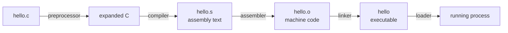

Run `clang -S hello.c` and open `hello.s` to see the assembly step for yourself.

**Assembly is the list of small steps the CPU actually runs.** The CPU has a few dozen registers, each holding one number. One instruction does one small thing: load from memory into a register, add two registers, store to memory, or jump. Here is one C function on both of your machines:

```
  int square(int x) { return x * x; }

  ARM64, your Mac (-O2)         x86-64 (-O2)
  _square:                      square:
      mul w0, w0, w0                mov  eax, edi
      ret                           imul eax, edi
                                    ret

  x arrives in w0,              x arrives in edi,
  the result leaves in w0       the result leaves in eax
```

That is enough assembly for now. Phase 3 teaches you to write it.

### Debugger fluency, day one

Spend two hours on this and it pays off every week for the rest of the path. In `lldb` (or `gdb` in the VM):

```
b main            breakpoint at main
r                 run
n / s             next line / step into
finish            run to end of current function
p var             print a variable
x/16xb &var       dump 16 bytes at that address (memory view)
disassemble       show the machine code for the current function
bt                stack trace
# GDB:  watch var
# LLDB: watchpoint set variable var
```

The two commands people never learn and should are `x/…` (look at raw memory) and `disassemble`. Use them on a tiny program today: declare an `int`, a `char[8]`, a `struct`, and a pointer, then look at their bytes.

### Beginner bridge: arrays before containers

Learn these distinctions before the linked list:

- **Length** is the number of valid elements; **capacity** is the number that fit in the allocation. Maintain `0 <= length <= capacity`.
- `sizeof array` measures the whole array only where it is still an array. A function parameter such as `int a[]` is adjusted to a pointer; pass its length too.
- Check allocation size arithmetic and failure. For `realloc`, keep the old pointer until the new allocation succeeds.
- A pointer drawing needs the owner and expiry point, not just an address. After `free`, copying the pointer does not make it valid again.
- Before copying a string, know the destination capacity, including the trailing zero. Your first copy function should reject insufficient capacity.

Use CS50 week 3, already in the primary course, for linear search, binary search, sorting and recursion. Search an array of 8, then 16, then 32 values and count comparisons. `O(n)` describes growth with input size, not elapsed seconds; phase 4 measures those seconds.

**Checkpoint:** append beyond an array's initial capacity, remove its last element, and handle an empty array without special memory errors. Explain which pointers remain valid after growth. Test empty input, one element and repeated growth before adding more features.

### Week by week

| Week | Watch or read | Build |
| --- | --- | --- |
| 1 | CS50 weeks 1 and 2 (C, arrays) | CS50 problem sets in the course environment, plus optional Exercism practice. Compile standalone local exercises with `clang -Wall -Wextra -g -fsanitize=address,undefined`. |
| 2 | CS50 week 3 (algorithms), week 4 (memory), Beej on pointers, arrays and strings; extend this week if needed | Your own `strlen`, `strcpy`, in-place string reverse and `swap` through pointers. Step through each one in Python Tutor and draw it on paper first. |
| 3 | CS50 week 5 (data structures), K&R chapter 6 | A linked list and a growable array with `malloc` and `free`, clean under ASan. Then a word counter that reads a text file. Put three of your functions in Compiler Explorer and match each line of C to its assembly. Finish with the debugger session above. |

### Project checklist

- [ ] You can write, compile and run a 100-line C program with warnings and sanitizers on
- [ ] You can draw the memory of a small program with pointers, then confirm the drawing in Python Tutor or `lldb`
- [ ] You can distinguish automatic, static and allocated lifetimes, explain the pointer variable's lifetime separately from the pointee's, and show why keeping a pointer does not extend the pointee's lifetime
- [ ] Linked list and growable array run clean under ASan
- [ ] You can match three lines of C to their assembly in Compiler Explorer

### Traps

- **Do not learn C++ first.** It is a much bigger language and hides the memory you are trying to see.
- **Do not skip the drawings.** Pointers make sense once you have drawn boxes and arrows for them. Reading about them is not enough.
- **Do not polish style yet.** Phase 2 changes how you write C. This phase only needs you to be able to write it.

## Phase 1: how a computer works, NAND gates to a running CPU (6 weeks)

Goal: build a working 16-bit computer from NAND gates in a hardware simulator, then write an assembler for it. After this, "the CPU fetches an instruction" is something you built, not something you read.

**Builds on:** phase 0b (small C programs). **Adds:** gates, adders, registers, RAM, a CPU that runs machine code, and an assembler. Write the assembler in Python if C still feels slow. The point here is the hardware.

### Why start here and not with C

After phase 0b you can write small C programs. What you do not have is the picture of what a CPU, a register, a bus and an instruction actually are. Every later phase (pointers, calling conventions, caches, virtual memory, GPU warps) is easier when you have built the thing once. This is the single highest-leverage six weeks in the roadmap.

### Primary resource

- **Nand2Tetris, part 1** (projects 1 to 6). Book: *The Elements of Computing Systems*, 2nd edition, Nisan and Schocken. Free course, software and project files at https://www.nand2tetris.org. The Coursera version is the same material with autograding. Do the projects, not the videos, unless you are stuck.
- **Companion for pictures:** Charles Petzold, *Code: The Hidden Language of Computer Hardware and Software*, 2nd edition (2022). Read chapters 1 to 24 in the evenings. It is the best-drawn explanation of relays, gates, adders and memory ever written. The interactive companion site is https://codehiddenlanguage.com.

Skip part 2 of Nand2Tetris (the Jack compiler and OS) for now. Phase 9 covers compilers with a better book.

### What you are actually learning

A computer is a small number of ideas stacked on top of each other. Nand2Tetris makes you build each layer:

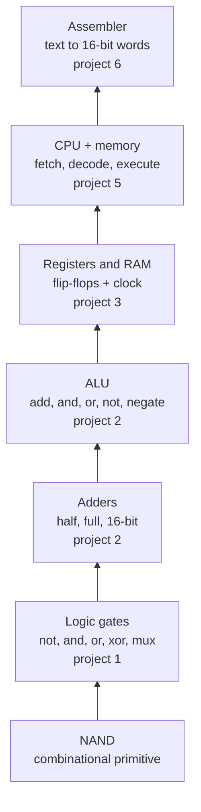

**The one idea in the CPU.** Everything the machine does is this loop, once per clock tick:

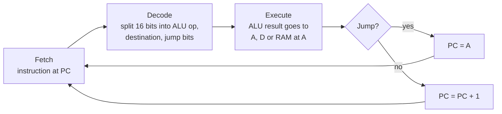

A real x86 or ARM core does the same three steps. It just does them for many instructions at once, out of order, with caches in between. Phases 3 and 4 add those details. The loop never changes.

**Before project 1:** a bit has two states; hexadecimal groups four bits per digit. Draw the truth table for AND, then show how a multiplexer selects one of two inputs. A bus is a group of signal lines, not another kind of arithmetic. Combinational outputs settle after inputs change; a clocked element captures state at a clock boundary. Nand2Tetris supplies a D flip-flop primitive for the sequential chips, not just NAND. Use the existing course's [project 1](https://www.nand2tetris.org/project01) and [project 3](https://www.nand2tetris.org/project03) explanations when these words first appear.

**State is a flip-flop plus a clock.** Combinational logic (gates, adders, the ALU) has no memory: outputs are a pure function of inputs. The moment you feed an output back to an input through a clocked flip-flop you get a register, and with registers you get RAM, a program counter and "the machine remembers." This is the boundary between math and a computer. Project 3 makes you cross it by hand.

**An instruction is just a number.** In Hack, `D=M+1;JGT` is the 16-bit word `1111110111010001`. The assembler you write in project 6 is a table lookup plus a symbol table for labels. That is genuinely all an assembler is. Phase 3's 8086 decoder is the same idea in reverse for a real ISA.

### Project checklist

- [ ] Projects 1 to 5: every chip passes the supplied test scripts in the hardware simulator
- [ ] Project 6: your assembler, written in C or Python, assembles `Pong.asm` to a byte-identical `Pong.hack`
- [ ] Extra: write a Hack CPU emulator in C. Read `.hack` files, run them, print the RAM. Under 300 lines. This is your first virtual machine and it makes phase 9 click later.
- [ ] Extra, optional, very worth it: Ben Eater's 8-bit breadboard computer video series (https://eater.net/8bit). You do not need to buy the kit. Watching him wire a clock, registers and an ALU by hand makes the Nand2Tetris chips physical.

### Traps

- Do not use the built-in chips to skip a project. The point is the ALU you sweat over.
- Do not read Petzold instead of doing the projects. Petzold is dessert.
- Do not go down the Verilog or FPGA hole yet. If you still want it after phase 11, Harris and Harris, *Digital Design and Computer Architecture*, RISC-V edition, is the book.

## Phase 2: C properly, memory, undefined behavior, arenas (8 weeks)

Goal: write C the way the handmade school writes it. Arena allocation instead of malloc per object, length-carrying strings instead of null-terminated ones, structs of plain data, no hidden control flow. Ship a small library and a JSON parser on top of it with zero sanitizer findings.

**Builds on:** phase 0b (pointers, `malloc`) and phase 1 (memory is addressed bytes that a CPU reads). **Adds:** C written properly, undefined behavior, sanitizers, arenas, the memory layout of a process.

### Primary resources

- **Book:** Jens Gustedt, *Modern C*, 3rd edition (covers C23, free PDF from the author, https://gustedt.gitlabpages.inria.fr/modern-c/). Levels 0 to 2 in this phase. It is precise about the language and honest about the awkward parts. Level 3 (threads, atomics) waits for phase 6.
- **Reference for the machine side:** *Computer Systems: A Programmer's Perspective* (CS:APP), 3rd edition, Bryant and O'Hallaron. Chapter 2 (bits, integers, floats) this phase. The book stays on your desk for phases 3, 4 and 5. The CMU 15-213 lecture videos exist, but read the book, do the labs.
- **Style, the part no book teaches:** Chris Wellons' blog, https://nullprogram.com. Read in this order: "Arena allocator tips and tricks" (2023), "My personal C coding style as of late 2023", "Let's implement buffered, formatted output" (2023), and Ryan Fleury, "Untangling Lifetimes: The Arena Allocator" (2022). These four posts are the actual curriculum for weeks 3 to 6.
- **One talk:** Eskil Steenberg, "How I program C" (2016, 2 h 10). Watch in week 1. Opinionated, and every opinion has a reason you can test.

If you find Gustedt too dense, K. N. King, *C Programming: A Modern Approach*, 2nd edition, is the gentler book. Pick one, not both.

### What you are actually learning

**A process sees a virtual address space.** This is a teaching diagram, not a promised layout. Mappings can be scattered; heaps need not grow as one contiguous region; page sizes and kernel mappings vary by OS and architecture. C objects occupy valid regions within that address space.

```
  high addresses
  ┌──────────────────┐
  │ kernel (off limits)│
  ├──────────────────┤
  │ stack              │  locals, return addresses, grows DOWN
  │   │                │  freed automatically when a function returns
  │   ▼                │
  │                    │
  │   ▲                │
  │   │                │
  │ heap               │  malloc / arenas, grows UP, you manage lifetime
  ├──────────────────┤
  │ .bss               │  zero-initialized globals
  │ .data              │  initialized globals
  │ .rodata            │  string literals, const tables
  │ .text              │  your machine code
  └──────────────────┘
  low addresses
```

On the targets here, an `int` normally occupies four bytes and a pointer eight; verify with `sizeof`. Pointer arithmetic scales by the pointed-to type. In C, arithmetic must stay within one array object or one position past its end; the one-past pointer cannot be dereferenced. An address alone is not permission to read: bounds, alignment, object lifetime and access type still matter. Inspect a small struct with `x/16xb` in LLDB, then explain which accesses are valid.

**A struct is a layout, not an object.** The compiler places fields in declaration order with padding so each field sits at a multiple of its alignment:

```c
struct bad  { char a; double b; char c; };   // 24 bytes: a, 7 pad, b, c, 7 pad
struct good { double b; char a; char c; };   // 16 bytes: b, a, c, 6 pad
```

Phase 4 turns this into a performance tool. For now, just know it and check it with `sizeof` and `offsetof`.

**Undefined behavior is the compiler's contract with you, not a bug you can ignore.** Signed overflow, out-of-bounds reads, use after free, uninitialized reads, and data races are UB. The compiler is allowed to assume they never happen and optimize on that assumption. This is why hosted C debug builds use `-fsanitize=address,undefined`. These tools detect many bugs in paths you execute, not every violation. They do not prove correctness or generally catch logical use-after-reset inside a still-allocated arena. Kernel and bare-metal targets need their own supported checks.

**Arenas replace most of malloc and free.** The idea Fleury and Wellons push, and the single biggest change in how you will write C:

```
  arena: one big block, a bump pointer, free everything at once

  ┌───────────────────────────────────────────────────┐
  │ used │ used │ used │ used │            free                   │
  └──────┴──────┴──────┴──────┴───────────────────────────────┘
                              ▲
                              │ next allocation starts here
```

```c
#include <stddef.h>
#include <stdlib.h>
#include <string.h>

typedef struct {
    unsigned char *base;
    size_t used, capacity;
} Arena;

// base comes from malloc(capacity), capacity > 0; no over-aligned types.
// Failure aborts. Zero count returns NULL and consumes no space.
static void *arena_alloc(Arena *a, size_t size, size_t align, size_t count) {
    if (!a || !a->base || a->used > a->capacity || size == 0 ||
        align == 0 || (align & (align - 1)) != 0 ||
        _Alignof(max_align_t) % align != 0) abort();
    if (count == 0) return NULL;
    size_t padding = (align - a->used % align) % align;
    size_t available = a->capacity - a->used;
    if (padding > available) abort();
    available -= padding;
    if (count > available / size) abort();
    size_t bytes = size * count;
    void *result = a->base + a->used + padding;
    a->used += padding + bytes;
    memset(result, 0, bytes);
    return result;
}
#define arena_new(a, type, count) \
    ((type *)arena_alloc((a), sizeof(type), _Alignof(type), (count)))
```

Things allocated together can die together. Resetting `used` invalidates every previous allocation logically, even though its bytes remain readable. Never return a view into a scratch arena you are about to reset. Growing an array by allocating and copying leaves old storage occupied until reset; existing views do not follow the new array.

This example checks size arithmetic and alignment but assumes the caller supplies a real backing allocation of the stated capacity. It zeroes bytes, not arbitrary language-level objects: initialize pointer fields explicitly rather than assuming all-bits-zero is universally a null pointer. Arena reset also does not close files or release other resources. Bulk memory lifetime and resource cleanup are separate responsibilities.

**Strings carry their length.** `char *` plus `strlen` is how you get buffer overflows and quadratic loops. Use a fat pointer:

```c
typedef struct { const char *data; size_t len; } Str;
#define S(lit) ((Str){(lit), sizeof(lit) - 1})  // string literals only
```

Slicing changes a pointer and length without copying, but must remain within the original range. Equality checks lengths first, then compares bytes (skip `memcmp` for empty views). A view owns nothing; document who keeps its bytes alive. At a libc boundary that expects a C string, make a terminated copy with room for the extra byte. Keep mutable buffers a separate type.

### Beginner bridge: a parser is a cursor plus a grammar

Before JSON, make the arena pass alignment, exact-fit, exhausted-capacity, zero-count and overflowing-size tests. Test that string views expire when their owner does. Inspect float bits with `memcpy` into a same-sized integer, not an incompatible pointer cast.

For JSON, use [RFC 8259](https://www.rfc-editor.org/rfc/rfc8259) as the syntax contract, especially sections 2 to 7. It adds the missing specification, not a second programming course.

```text
input bytes + cursor + end
    skip whitespace
    inspect next byte
        '"'       -> string parser
        '['       -> repeat value, separated by commas, until ']'
        '{'       -> repeat string ':' value, until '}'
        number    -> validate number grammar
        t/f/n     -> match true/false/null
    skip whitespace
    require end of input
```

Start with numbers and arrays; then strings and objects. Every read checks the end. Every error reports a byte offset. Set input-size and nesting limits before recursion becomes a stack overflow. Define how you represent large numbers instead of silently rounding every integer to `double`.

Test escapes, Unicode including surrogate pairs, `\u0000` inside a string, truncated input, invalid numbers, trailing junk and deep nesting. In JSONTestSuite, `y_` means accept, `n_` means reject, and `i_` permits implementation-dependent outcomes that you should document. A parser that accepts valid input but crashes on invalid input is not finished.

**Small test ladder:** known examples → serialize/parse round trips → test suite → generated malformed inputs. [LLVM's libFuzzer guide](https://llvm.org/docs/LibFuzzer.html) explains a coverage-guided byte-input harness if random testing stops finding new paths. Save minimized failures as regression tests. A round trip alone is not an oracle: two functions can share the same bug.

### Week by week

| Week | Read | Build |
| --- | --- | --- |
| 1 | Modern C level 0 and 1, Steenberg talk | Rewrite three Leetcode solutions in plain C with the phase 0 build script. Get them clean under sanitizers. |
| 2 | CS:APP chapter 2, do the Data Lab (bit puzzles) | Data Lab. Then write `print_bits` and a float-to-bits dumper. Understand two's complement and IEEE 754 by looking at bytes. |
| 3 | Fleury arena post, Wellons arena post | Arena allocator, `Str` type, a dynamic array macro that grows inside an arena. Test each with a tiny driver. |
| 4 | Modern C level 2, chapters on pointers and structs | Hash map (open addressing, string keys) on top of the arena. Benchmark against nothing, just make it correct. |
| 5 | Wellons buffered output post | A `printf`-like formatter that writes to a buffer, then a file. No libc `printf` in your library after this. |
| 6 | Modern C on the preprocessor, `static`, `inline`, headers | Split the library into a single header. Understand what a translation unit is and why single-TU builds work. |
| 7 to 8 | nothing new | **The project:** a JSON parser and serializer using only your library. Recursive descent, arena-allocated tree, fat strings. Must parse the JSON test suite at https://github.com/nst/JSONTestSuite with the correct accept and reject results. |

### Project checklist

- [ ] Arena, `Str`, dynamic array, hash map, formatter, all in one header, all sanitizer-clean
- [ ] JSON parser passes the JSONTestSuite `y_` and `n_` files
- [ ] You can explain, with `x/` in the debugger, exactly where every byte of a parsed document lives
- [ ] You have not called `malloc` directly anywhere except inside the arena's backing allocation

### Traps

- **Do not learn C++ features "to make C nicer."** No templates, no classes, no exceptions. The friction you feel is the point. Phase 13 revisits C++.
- **Do not write a general-purpose library.** Write what the JSON parser needs. Semantic compression means you pull out shared code the third time, not the first.
- **Do not skip the Data Lab.** Bits, overflow and floats are the foundation of phase 4 and phase 8.

## Phase 3: machine level, assembly, what the compiler emits, linking (8 weeks)

Goal: write small programs in ARM64 and x86-64 assembly by hand, then read both fluently enough to look at any C function in Compiler Explorer and say what it does. Know what a stack frame, a calling convention, a relocation and a dynamic symbol are because you have stepped through them. Ship hand-written assembly on both ISAs and an 8086 decoder and simulator.

**Builds on:** phase 1 (what an instruction is) and phase 2 (pointers, stack and heap). **Adds:** writing and reading ARM64 and x86-64 assembly, calling conventions, linking.

### Primary resources

- **Assembly 101 on ARM64, natively on your Mac:** Stephen Smith, *Programming with 64-Bit ARM Assembly Language* (Apress, 2020), together with the HelloSilicon repo, https://github.com/below/HelloSilicon. The repo ports every example in the book to Apple Silicon and notes each place where macOS differs from Linux. Chapters 1 to 7 in week 1: registers, loading and adding, the tools, branches and loops, memory, functions and the stack, OS calls. Type every program, build it with `as` and `ld` or through `clang`, and step through it in `lldb`.
- **Assembly 101 on x86-64:** Ed Jorgensen, *x86-64 Assembly Language Programming with Ubuntu*, free PDF at http://www.egr.unlv.edu/\~ed/assembly64.pdf. In week 2 you redo the week 1 programs in x86-64 in the Linux VM. The book uses yasm. nasm accepts the same syntax for everything you write here.
- **Casey Muratori, Computer Enhance, "Interlude: 8086 decoding and simulation"** (part 1 of the Performance-Aware Programming course, https://www.computerenhance.com, paid subscription, 15 USD per month). This is the best on-ramp to instruction encoding that exists. You write a decoder for real 8086 machine code, then a simulator, then estimate cycle counts. Casey's reasoning about why the ISA looks the way it does is the actual lesson.
- **CS:APP chapter 3** (machine-level representation of programs) for x86-64. Do the Bomb Lab and the Attack Lab from https://csapp.cs.cmu.edu/3e/labs.html. They are the two best assembly exercises ever designed and they are free.
- **CS:APP chapter 7** (linking). Read it in week 7 while building a multi-file program by hand with `clang -c` and `ld`.
- **Compiler Explorer**, https://godbolt.org, open all day every day. Compile with `-O0`, then `-O2`, then an explicit CPU target, and compare. On Compiler Explorer, `-march=native` refers to its compilation host, not your laptop.
- **ARM64 reference:** the Apple Silicon documentation is thin, so use the ARM "Learn the architecture: A64 Instruction Set" guide on developer.arm.com, Apple's "Writing ARM64 code for Apple platforms" page on developer.apple.com for the ABI differences, and Compiler Explorer with `armv8-a clang`. Keep all three open whenever you read ARM64 output.

### Beginner bridge: instruction set, ABI, file format

- **ISA:** which instructions the CPU executes. ARM64 and x86-64 are different ISAs.
- **ABI:** how separately compiled code agrees on arguments, return values, saved registers and stack alignment. Two OSes on the same ISA can use different ABIs.
- **Object format:** how code, symbols and relocations are stored in a file. Linux uses ELF; macOS uses Mach-O.

Start with one assembly `add` called from C. Use `clang` to assemble and link so its driver supplies runtime startup files and libraries. Once that works, inspect the commands with `clang -###`; direct `ld` is a later linking exercise, not the default way to link a libc program. Apple raw syscalls are an educational experiment, not a stable application interface. Prefer libc calls for normal macOS assembly.

Install `nasm` in your chosen Ubuntu x86 environment with `sudo apt install nasm` before the x86 exercises. A normal ARM64 Linux guest does not automatically execute x86 binaries; use the explicitly configured emulation environment or native laptop.

Use the [official LLDB/GDB command map](https://lldb.llvm.org/use/map.html) when a debugger command differs. **Checkpoint:** explain why valid ARM64 instructions can still crash when called with the wrong ABI. Preserve callee-saved registers and demonstrate a nested call before attempting recursion.

### What you are actually learning

**A function call is a protocol, not magic.** The System V ABI on x86-64 Linux and macOS says: first six integer arguments go in `rdi, rsi, rdx, rcx, r8, r9`, return value in `rax`, `rsp` points to the stack top, `rbp` is an optional frame pointer, callee must preserve `rbx, rbp, r12 to r15`. Everything about "the stack" follows from that:

```
  caller:                                  higher addresses
    push args 7+ (if any)                 ┌─────────────────┐
    call f          ; pushes return addr  │ caller's frame  │
                                          ├─────────────────┤
  f:                                      │ return address  │ ◄─ pushed by `call`
    push rbp        ; save old frame      ├─────────────────┤
    mov  rbp, rsp   ; new frame base      │ saved rbp       │ ◄─ rbp points here
    sub  rsp, 32    ; room for locals     ├─────────────────┤
    ...             ; locals at [rbp-8],  │ local a         │
                    ;   [rbp-16], ...     │ local b         │
    mov  rsp, rbp   ; drop locals         │ (padding)       │ ◄─ rsp points here
    pop  rbp        ; restore caller      └─────────────────┘
    ret             ; pops return addr     lower addresses
```

A stack-buffer overflow can overwrite neighboring locals or saved control data, including a return address in the lab's layout. Not every overflow reaches that address. The Attack Lab supplies deliberately vulnerable programs to study the mechanism. Recursion is just this frame stacked N times. A stack overflow is running out of the region.

**The compiler is a rewriting machine and `-O2` is aggressive.** Things you will see in Compiler Explorer and should be able to name: inlining, loop unrolling, strength reduction (`x * 8` becomes `x << 3`), dead store elimination, tail calls, vectorization (phase 4), and the compiler deleting your whole benchmark because the result was unused. This last one is why every benchmark needs a sink.

**Linking turns object files into a program by resolving names to addresses.**

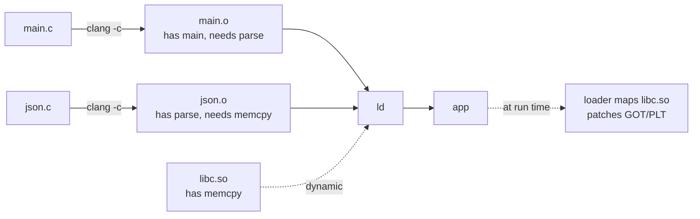

Each `.o` has sections (`.text`, `.data`, `.rodata`, `.bss`), a symbol table, and relocations: "at offset 0x2f in .text, write the address of `parse`." Static linking resolves all of them at build time. Dynamic linking leaves some for the loader. On Linux the format is ELF, on macOS it is Mach-O, and the ideas are identical. Tools: `nm`, `objdump -d`, `readelf` (Linux), `otool` (macOS).

**x86-64 and ARM64 differ in encoding and philosophy, not in ideas.** x86 is variable-length, memory operands almost anywhere, decades of accretion. ARM64 is fixed 32-bit instructions, load/store only, 31 general registers. Learning both makes the concept of "ISA" abstract in your head, which is what you want before RISC-V shows up in phase 5.

**The ARM64 calling convention on your Mac.** Arguments go in `x0` to `x7` and the return value in `x0`. `bl` puts the return address in the link register `x30` instead of pushing it on the stack. A function that calls another function must save `x30` itself, usually with `stp x29, x30, [sp, #-16]!` at the top and `ldp x29, x30, [sp], #16` before `ret`. `x29` is the frame pointer and `sp` stays 16-byte aligned. Apple differs from Linux in a few spots: `x18` is reserved, variadic arguments (the ones `printf` takes) go on the stack, C symbols get a leading underscore (`_main`), and a syscall is `svc #0x80` with its number in `x16`.

```
  int add(int a, int b) { return a + b; }

  x86-64, Linux (-O2)          ARM64, macOS (-O2)
  add:                         _add:
      lea eax, [rdi + rsi]         add w0, w1, w0
      ret                          ret
```

### Week by week

| Week | Read | Build |
| --- | --- | --- |
| 1 | Smith chapters 1 to 7, through HelloSilicon | Assembly 101 on ARM64, natively on the Mac. By hand: a hello world that uses only the `write` and `exit` syscalls, `strlen`, `memcpy`, a loop that sums an array, and a recursive `fib`. Call each one from a C `main` and step through it in `lldb`. |
| 2 | Jorgensen, the chapters on instructions, control flow, functions and system services | The same five programs in x86-64, in the Linux VM, with nasm and gdb. Put both versions side by side and write down where the arguments live, how the return address is saved and how the stack is aligned. |
| 3 to 4 | Computer Enhance 8086 interlude, first half | 8086 decoder in C. Feed it the course's listings, produce byte-identical reassembly via `nasm`. |
| 5 | Computer Enhance second half | 8086 simulator: registers, flags, memory, jumps. Run the course's programs. Print estimated cycles. |
| 6 | CS:APP chapter 3, sections 3.1 to 3.8 | Bomb Lab in the Linux VM. Pure disassembly reading, no source. |
| 7 | CS:APP 3.10 (buffer overflow), chapter 7 | Attack Lab. Then build your phase 2 JSON parser as three `.o` files linked through `clang`. Inspect the driver's `ld` invocation and identify its runtime inputs. Read the ELF with `readelf -a`. |
| 8 | ARM A64 guide chapters on registers, load/store and branches, Apple's ARM64 ABI page | Read clang's ARM64 output at `-O0` and `-O2` for your phase 2 arena and JSON parser. Pick one hot function, rewrite it by hand in ARM64, and benchmark it against clang's version. |

### Project checklist

- [ ] The five week 1 programs run on ARM64 (Mac) and x86-64 (VM), written by hand and called from C
- [ ] You can write an assembly function that calls another function on both ISAs and explain every stack adjustment in it
- [ ] 8086 decoder round-trips every listing in the course
- [ ] Simulator runs the course programs with matching register and flag state
- [ ] Bomb Lab all six phases defused; Attack Lab at least through level 3
- [ ] You can draw the stack frame of a recursive C function from its disassembly, without running it
- [ ] You can explain what `-O2` changed in a 30-line function, instruction by instruction
- [ ] You can read clang's ARM64 output at `-O2` as easily as its x86-64 output

### Traps

- Do not learn assembly by writing large programs in it. Read a lot, write a little. The compiler writes assembly, you read it.
- Do not memorize the x86 instruction set. Learn the 30 instructions that account for 95% of compiled code: `mov, lea, add, sub, imul, and, or, xor, shl, shr, cmp, test, jmp, jcc, call, ret, push, pop, movs/movz, cmov, setcc` plus the SSE moves and arithmetic.

## Phase 4: memory hierarchy, performance-aware programming, data-oriented design, SIMD (10 weeks)

Goal: explain a hot loop's bottleneck with measurements and a simple cost model. Measure cache effects, branch prediction, arithmetic and memory bandwidth on your hardware. Improve a correct program, then explain the remaining gap. A 100x speedup is a stretch experiment when the baseline contains that much waste, not a requirement to manufacture a slow baseline.

**Builds on:** phase 3 (reading compiler output). **Adds:** caches, profiling, SIMD, data-oriented design.

### Primary resources

- **Casey Muratori, Computer Enhance, parts 2 to 4** ("Profiling and measurement", "Moving data", "Reading and writing data with SIMD and cache"). The haversine project runs through the whole course. Do every homework. This is the spine of the phase.
- **Sergey Slotin, *Algorithms for Modern Hardware***, https://en.algorithmica.org/hpc/. Free, and the best written treatment of caches, SIMD, branchless code and memory-bound algorithms. Chapters on the CPU pipeline, memory, SIMD and "algorithm case studies". Read it alongside the course.
- **MIT 6.172 Performance Engineering of Software Systems** (Fall 2018, OCW, https://ocw.mit.edu/courses/6-172-performance-engineering-of-software-systems-fall-2018/). Lectures 1, 2, 4, 5, 9, 10, 14 and the matrix multiplication homework. Leiserson's lecture 1 takes a 4096³ matmul from 21,000 seconds in Python to 0.4 seconds in C, step by step. Watch it in week 1.
- **Ulrich Drepper, "What Every Programmer Should Know About Memory"** (2007, https://www.akkadia.org/drepper/cpumemory.pdf). Sections 2 to 6 only. Use it for the model, not as a specification of today's CPUs. Measure current cache topology, latency and bandwidth yourself.
- **Talks, one each:** Mike Acton, "Data-Oriented Design and C++" (CppCon 2014), second viewing, now you will get it. Andrew Kelley, "A Practical Guide to Applying Data-Oriented Design" (Handmade Seattle 2021). Casey Muratori, "Simple Code, High Performance" (2021, the refterm talk).
- **Reference:** Agner Fog's optimization manuals, https://www.agner.org/optimize/, manual 1 (optimizing C++) and 3 (microarchitecture). Look things up, do not read cover to cover. Also the uops.info instruction tables for latencies and throughputs.

### What you are actually learning

**The memory hierarchy often sets the limit.** Illustrative numbers for an x86-like core, not specifications for your Mac:

```
                       size        latency      what fits
  registers            ~1 KB       varies      instruction-dependent access/compute cost
  L1 data cache        32-64 KB    ~4 cycles    your hot loop's working set
  L2                   1-2 MB     ~14 cycles    a small table
  L3 (shared)         16-64 MB    ~50 cycles    a medium table
  DRAM                 GBs      ~80-100 ns      everything else (~300 cycles)
  SSD                  TBs      ~50-100 us      ...

  this example assumes 64-byte lines. query your CPU: Apple Silicon differs.
```

A loop that touches memory in order and uses every byte it fetches runs at DRAM bandwidth, tens of GB/s. A loop that chases pointers pays 100 ns per hop and runs at maybe 10 million hops per second. That is a 100x gap from data layout alone, before any algorithmic cleverness. Dependent loads, poor locality, allocation overhead and branch behavior can all contribute. A pooled tree or a tiny list can behave differently; measure the actual workload.

**Array of structs versus struct of arrays.** The concrete form of "data-oriented design":

```
  AoS: struct { float x, y, z, mass; int id; char name[32]; } particles[N];

       memory: [x y z m id name....][x y z m id name....][x y z m id ...
       to update every x you fetch 52 bytes per particle and use 4.

  SoA: struct { float *x, *y, *z, *mass; int *id; char (*name)[32]; } particles;

       memory: [x x x x x x x x x x x x ...][y y y y y ...][z z z ...]
       to update every x you fetch 64 bytes and use 64. 16 floats per line.
       and the compiler can vectorize it.
```

Acton's talk is 90 minutes on this one idea and its consequences. Kelley's talk shows the practical moves: shrink structs, replace pointers with 32-bit indices into arrays, store the variant tag in a separate array, put the rare fields in a side table.

**Branches are predicted, and a mispredict costs about 15 cycles.** Sorted data with a `if (x > 128)` branch is fast, random data is slow, and a branchless version may help unpredictable data. It can also do extra work or lengthen dependencies. Inspect whether the compiler emitted a branch and measure all variants; source syntax alone does not decide. Algorithmica's chapter on branchless programming is the reference.

**SIMD does 4, 8 or 16 lanes per instruction.**

```
  scalar:   a[0]+b[0]   a[1]+b[1]   a[2]+b[2]   a[3]+b[3]     4 instructions

  SIMD:     ┌ a0 a1 a2 a3 ┐   ┌ b0 b1 b2 b3 ┐   ┌ a0+b0 a1+b1 a2+b2 a3+b3 ┐
            └────────────┘ + └────────────┘ = └────────────────────────┘   1 instruction
                 128-bit register (SSE / NEON), 4 floats
                 256-bit (AVX2) = 8 floats, 512-bit (AVX-512) = 16
```

The compiler auto-vectorizes simple loops over SoA data. For everything else you write intrinsics: `_mm256_add_ps` on x86, `vaddq_f32` on ARM NEON. Your Mac supports NEON; native x86 support for SSE/AVX depends on the CPU. Emulated instruction availability is not a performance guarantee. Learn the shared lane model, then check each ISA's alignment, mask, shuffle and tail-handling rules.

**Measure with a profiler, a repeatable timer and a model.** Start with a monotonic OS clock. Report both minimum and median across repeated runs, plus outliers when latency matters. Raw counters are a later exercise: invariant x86 TSC ticks and ARM `cntvct_el0` timer ticks are not current-frequency CPU cycles. Learn frequency conversion, ordering and measurement overhead before using them. A profiler identifies where time goes; a bandwidth or throughput model helps explain why.

**Non-pessimization before optimization.** Casey's ordering: first do not write slow code (no allocation per element, no virtual dispatch per element, no pointer chasing, no copying you do not need). That gets you 10x to 100x on typical code. Then, only for the hot loop, actual optimization: SIMD, cache blocking, prefetching. Most programs never need the second step.

### Beginner bridge: correctness and units before speed

Use the same inputs and outputs for every version. Record CPU, OS, compiler, flags, data size, warm/cold state and whether file I/O is timed. Consume a result checksum so the compiler cannot delete the benchmark; inspect optimized assembly when in doubt. Time optimized, non-sanitized builds only after testing.

```text
bandwidth estimate = bytes moved / seconds
throughput         = operations / seconds
arithmetic intensity = operations / bytes moved
rough lower bound  = max(bytes / bandwidth, operations / compute throughput)
```

This lower bound ignores dependencies and overhead, so failing to reach it is a question to investigate, not proof your code is bad. Cache traffic can exceed your source-level byte count.

For haversine, specify coordinate ranges and an absolute/relative error policy against a double-precision reference. Test identical, nearby and nearly antipodal points. Replacing `strtod` with a parser for your generator's limited format is valid only if you state that narrower contract. NEON/AVX arithmetic does not directly provide vector `sin` and `asin`; use an identified vector-math implementation or a tested approximation, and account for its error.

For SIMD, first add two arrays. Then handle a length that is not a multiple of the lane count without reading past the end. Keep the scalar implementation as the oracle. Run x86 timing on the native laptop, ARM timing on the Mac. An x86 emulator measures its translated execution, not an Intel/AMD microarchitecture.

### Week by week

| Week | Read or watch | Build |
| --- | --- | --- |
| 1 | 6.172 lecture 1, Computer Enhance part 2 start | Haversine generator and naive parser (reuse your phase 2 JSON parser). Measure. It is slow. |
| 2 | Computer Enhance part 2 | Your own block profiler with a monotonic clock, then a repetition tester. Raw-counter timing is a follow-up. Instrument the haversine pipeline. |
| 3 | Drepper sections 2 to 4, Algorithmica "Memory" chapter | Cache latency and bandwidth probes: measure the cache levels and DRAM available on your native Mac and native x86 laptop. Plot them. Your numbers, not the table above. |
| 4 | Computer Enhance part 3, Acton talk again | Rewrite the haversine parser to touch each byte once, arena-allocated, no `strtod`. Target 10x. |
| 5 | Algorithmica "Branchless" and "Pipelining" chapters | Branch prediction probes. Sorted vs unsorted array sum. Branchless variant. Confirm with `perf stat`. |
| 6 | Kelley talk, Algorithmica hash table chapter | Redo your phase 2 hash map: SoA, 32-bit indices, no per-entry allocation, linear probing. Benchmark old vs new at 1M keys. |
| 7 | Computer Enhance part 4, Algorithmica SIMD chapter | Hand-vectorize the haversine math with NEON intrinsics on the Mac and AVX2 on a supporting native x86 CPU. Compare to clang's auto-vectorization. |
| 8 | 6.172 lectures 4, 5, 14 | Matrix multiply: naive, loop reorder, blocking for L1 and L2, SIMD. Aim for 50% of peak FLOPS. This is the warmup for phase 8. |
| 9 | Agner Fog manual 3, chapters on the out-of-order core | Microbenchmark instruction latency vs throughput (dependent adds vs independent adds). Understand ILP from your own numbers. |
| 10 | nothing new | **The project:** a correct, profiled haversine pipeline with a reproducible before/after comparison. Under 100 ms for 10M points is a hardware- and format-dependent stretch goal. Write the 200-word Sunday note as a full retrospective. |

### Project checklist

- [ ] Haversine pipeline has a verified output, repeated before/after timings and a written bottleneck explanation; 100x is stretch
- [ ] A profiler and repetition tester you wrote and will reuse in phases 5, 7 and 8
- [ ] Cache and branch probes with plots of your hardware's real numbers
- [ ] SoA hash table compared at a stated load factor, hit/miss mix and key distribution; explain the result, including regressions
- [ ] Correct blocked SIMD matmul with a throughput model; 50% of a clearly defined one-core peak is stretch

### Traps

- **Do not trust `-O3` or the compiler to save you.** Look at the assembly. Half of "vectorized" loops are not.
- **Do not infer native hardware performance from cross-ISA emulation.** A same-ISA VM is useful for API work, but counters and scheduling can still differ from the host. State which environment each measurement used.
- **Do not optimize before measuring.** The profiler comes in week 2 for a reason.

## Phase 5: operating systems, xv6, syscalls, virtual memory, filesystems, sockets (12 weeks)

Goal: know what the kernel does for your program, because you modified a real kernel to do it. Processes, threads, virtual memory, the page table walk, the scheduler, the filesystem, the syscall boundary. Then use that knowledge from userspace: your own shell, your own malloc, your own event loop on `epoll` and `kqueue`.

**Builds on:** phase 3 (registers, stack frames, calling conventions) and phase 4 (the memory hierarchy). **Adds:** processes, syscalls, virtual memory, filesystems, sockets.

### Primary resources

- **OSTEP, *Operating Systems: Three Easy Pieces***, Arpaci-Dusseau, free at https://pages.cs.wisc.edu/\~remzi/OSTEP/. The best OS textbook, and short chapters. Virtualization (chapters 3 to 24), concurrency (25 to 34, but phase 6 covers this deeper), persistence (35 to 45).
- **MIT 6.1810 Operating System Engineering**, use the archived Fall 2025 offering at https://pdos.csail.mit.edu/6.1810/2025/, labs on the xv6-riscv kernel, https://github.com/mit-pdos/xv6-riscv. Use that offering's lab repository, book and toolchain together. Lab names and counts change between years; the weekly topic map below is not its exact assignment calendar. Read the xv6 book (PDF on the course site) chapter by chapter with the labs. RISC-V is a third ISA for you and it is the simplest of the three. Runs on QEMU in your Linux VM.
- **Michael Kerrisk, *The Linux Programming Interface*** (2010). The userspace reference. You do not read it, you look things up: file I/O, processes, signals, `mmap`, sockets, `epoll`. It is still the standard because the interface has not changed.
- **Beej's Guide to Network Programming**, current online edition at https://beej.us/guide/bgnet/. Free, short, and the only sockets tutorial you need.
- **Talk:** Casey Muratori, "The Thirty Million Line Problem" (2015). On what all this OS code costs and why it exists.

### What you are actually learning

**The kernel's job is to multiplex hardware and to lie convincingly.** Every process believes it has the whole CPU (the scheduler switches them thousands of times a second) and the whole address space (virtual memory maps it onto scattered physical pages). The lie is enforced by the CPU: user mode cannot touch page tables or devices, so the only way to do anything real is a syscall, which is a controlled trap into the kernel.

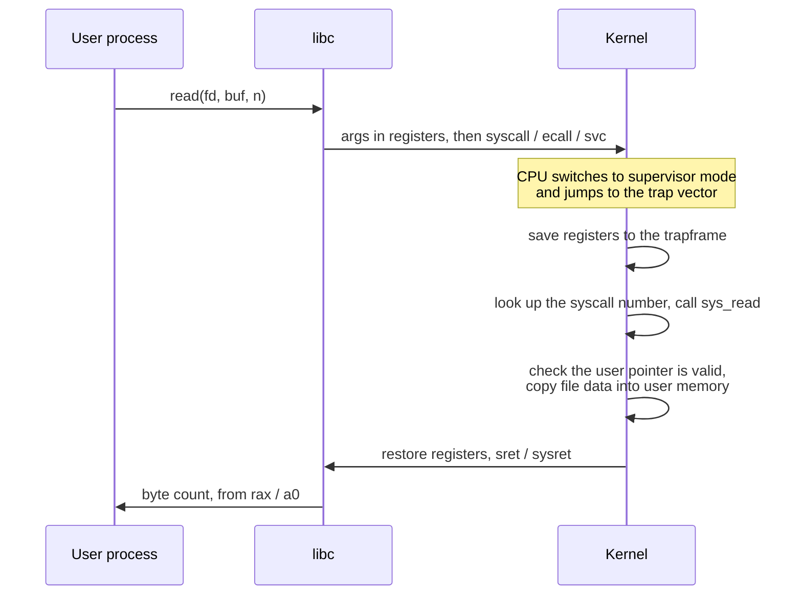

xv6 lab "system calls" makes you add one. After that, the boundary is not mysterious.

A process moves between three states, and the scheduler makes every transition:

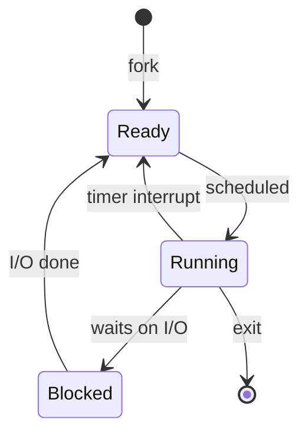

**Virtual memory is a tree lookup done by hardware.**

```
  virtual address (RISC-V Sv39, 39 bits used)
  ┌─────────┬─────────┬─────────┬──────────────┐
  │ L2 (9b) │ L1 (9b) │ L0 (9b) │ offset (12b) │
  └─────────┴─────────┴─────────┴──────────────┘
```

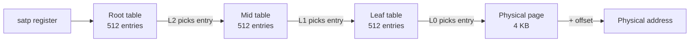

Each entry holds a physical page number and flags (valid, readable, writable, executable, user). The TLB caches recent translations, so most accesses skip the walk.

A TLB miss can require one three-level Sv39 page-table walk, with intermediate entries potentially cached. The TLB usually avoids this walk. A TLB miss costs tens to hundreds of cycles. This is why phase 4 said "touch memory in order": you also stay on the same 4 KB page. And it is why huge pages (2 MB) exist. The "page tables" and "copy-on-write fork" xv6 labs make you build all of this.

**A file descriptor is an index into a per-process table of open files.** `open` returns a small integer, the kernel keeps the real state (offset, inode, permissions), and `read`, `write`, `close`, `mmap`, `poll` all take that integer. Pipes, sockets, terminals and devices all sit behind the same interface. This uniformity is the Unix idea, and it is why your event loop in week 10 can wait on a socket and a timer with one call.

**A filesystem is a data structure on a block device with crash consistency as the hard part.** Inodes hold metadata and block pointers, directories map names to inode numbers, a bitmap tracks free blocks, and a log or journal makes multi-block updates atomic across a crash. The xv6 filesystem is 1,000 lines and has all of these. Phase 12 builds a storage engine on top of a filesystem, rather than a filesystem itself.

### Beginner bridge: ownership crosses the syscall boundary

Before the xv6 labs, read the selected xv6 book's RISC-V register and trap explanation. You already know what an ABI does; now identify `a0` to `a7`, `sp`, `ra`, `ecall`, and the trap-return instruction. Do not translate x86 assembly instruction by instruction.

A descriptor is a resource to close, not memory to free. In a pipeline, draw which process owns every pipe end. Close unused ends after `fork`; otherwise a reader may never see EOF. Build a foreground command first, then redirection and a two-command pipeline. `waitpid`, process groups and foreground-terminal control come before full background-job handling.

An event loop starts smaller than HTTP:

```text
accept connection -> nonblocking socket -> wait for readiness
    readable: read some bytes -> append to bounded input buffer
    writable: send queued bytes -> keep any unsent suffix
    EOF/error/timeout: remove from loop -> close -> free state
```

Readiness means an operation can make progress, not that a complete request has arrived. Handle short reads/writes, `EINTR`, `EAGAIN`, EOF and backpressure (stop accepting more work when output cannot drain). Start level-triggered; read [epoll(7)](https://man7.org/linux/man-pages/man7/epoll.7.html) before edge-triggering.

**Checkpoint:** echo works when a client sends one byte at a time, when another stops reading, and when one disconnects mid-message. Other clients still progress. Bound buffers, connection counts and timeouts. Then implement a documented HTTP subset; [RFC 9112 sections 2, 3 and 6](https://www.rfc-editor.org/rfc/rfc9112) specify parsing and message framing. Reject unsupported framing and prevent file paths escaping the serving directory. Keep the learning server on loopback or an isolated lab network.

Nonblocking sockets do not make disk reads nonblocking. Preload a small fixture set first; move disk work off the loop in phase 6. For the allocator, test alignment, splitting, coalescing and `realloc` semantics in a driver before `LD_PRELOAD`. Replacing a process allocator also requires compatible `calloc`/`realloc`, threading and initialization behavior; Python is a stretch integration test.

### Week by week

| Week | Read | Build |
| --- | --- | --- |
| 1 | OSTEP 4 to 6, xv6 book chapter 1 and 2 | xv6 up in QEMU in your VM. Labs: `util` (write `sleep`, `pingpong`, `primes`, `find`, `xargs` as xv6 user programs). |
| 2 | OSTEP 7 to 11, xv6 book chapter 4 | Lab: `syscall` (add tracing and a `sysinfo` call). Read `trap.c` and `syscall.c` line by line. |
| 3 to 4 | OSTEP 13 to 20, xv6 book chapter 3 | Labs: `pgtbl` and `traps`. Draw the xv6 address space and page table on paper. |
| 5 | OSTEP 21 to 22 | Labs: `cow` (copy-on-write fork) and `lazy` or `mmap` depending on the year's set. |
| 6 | OSTEP 26 to 30, xv6 book chapter 6 and 7 | Labs: `thread` and `lock`. Read `proc.c`, especially `scheduler` and `swtch.S`. Draw a context switch. |
| 7 | OSTEP 39 to 42, xv6 book chapter 8 | Lab: `fs` (large files, symlinks). Read `fs.c` and `log.c`. |
| 8 | TLPI chapters on `fork`, `exec`, signals, pipes | **Userspace project 1:** a shell in C on Linux. Pipes, redirection, background jobs, signal handling for Ctrl-C. Use your phase 2 library. |
| 9 | OSTEP 17, TLPI on `mmap` and `brk` | **Userspace project 2:** a `malloc` and `free` on top of `mmap`. Size classes, free lists, coalescing. Run real programs against it with `LD_PRELOAD`. Benchmark against glibc with your phase 4 tester. |
| 10 to 11 | Beej's guide, TLPI on sockets and `epoll` | **Userspace project 3:** an event loop with `epoll` (Linux) and `kqueue` (macOS) behind one interface. On top of it, a bounded HTTP/1.1 subset server that serves preloaded static files without blocking its event-loop thread. Scale toward 10k connections only after the correctness tests pass. Load test with `wrk`. |
| 12 | OSTEP 36 to 38 (I/O devices, disks) | Read the xv6 `virtio_disk.c` driver. Then read the Linux `read` syscall path in the kernel source, from `ksys_read` down to the block layer, with a browser like https://elixir.bootlin.com. Just read. |

### Project checklist

- [ ] The selected xv6 labs pass their matching course-year grading scripts; record any deferred labs
- [ ] Shell runs `ls | grep c | wc -l > out.txt &` correctly
- [ ] Allocator passes its test driver; running `python3` or `sqlite3` via `LD_PRELOAD` is stretch
- [ ] HTTP server passes slow-client and disconnect tests; record load-test limits, descriptor limits and latency. 10k connections is stretch
- [ ] You can draw, from memory, the syscall path, the page table walk and a context switch

### Traps

- Do not read OSTEP end to end first. Each week's chapters unblock that week's lab, in that order.
- Do not use a thread per connection in the HTTP server. The point is the event loop, and phase 6 will add the threads correctly.
- Do not port xv6 to your Mac. It runs in QEMU in the Linux VM and that is fine.

## Phase 6: concurrency and parallelism, memory models, job systems (6 weeks)

Goal: write multithreaded C that is correct under the C11 memory model and fast on a 10-core machine, and know the difference. Ship a work-stealing job system and use it to parallelize your phase 4 haversine and matmul.

**Builds on:** phase 4 (cache lines) and phase 5 (threads and the scheduler). **Adds:** atomics, memory models, locks, job systems.

### Primary resources

- **Mara Bos, *Rust Atomics and Locks*** (2023, free at https://marabos.nl/atomics/). Yes, it is a Rust book, and it is the clearest explanation of atomics, memory ordering, spinlocks, mutexes and condition variables in print. Chapters 1 to 6 and 8 to 9. The concepts are identical in C11 `stdatomic.h`. Read it now, before you know Rust, and it will make phase 7 easier.
- **Paul McKenney, *Is Parallel Programming Hard, And, If So, What Can You Do About It?*** (free, use the revision listed at https://cdn.kernel.org/pub/linux/kernel/people/paulmck/perfbook/perfbook.html). Chapters 3 (hardware), 4 (tools), 5 (counting), 7 (locking) and appendix C (memory barriers). McKenney wrote RCU for the Linux kernel. When he says something about cache coherence, it is true.
- **Stanford CS149 Parallel Computing** (Fall 2023 lecture videos on YouTube, linked from https://gfxcourses.stanford.edu/cs149/fall25). Lectures 1 to 6 and 10 to 12. Best treatment of the "why is parallel code slow" side: false sharing, load imbalance, Amdahl, work distribution.
- **OSTEP chapters 26 to 34** as the gentle version if Bos and McKenney are too dense.
- **Modern C level 3** for the C11 threads and atomics API itself.

### What you are actually learning

**Cache coherence makes sharing expensive.** Cache topology depends on the CPU; for example, some cores share an L2 within a cluster. When two cores write to the same cache line, the line ping-pongs between them at \~100 cycles a bounce. This happens even when they write to different variables that happen to share a line: false sharing.

```
  core 0 writes counter[0]          core 1 writes counter[1]
         │                                   │
         ▼                                   ▼
  ┌───────────────────────────────────────────────────────────────┐
  │ counter[0] │ counter[1] │ counter[2] │ ... one 64-byte line  │
  └───────────────────────────────────────────────────────────────┘
              the line bounces between the two cores' caches on every write.
              fix: pad each counter to its own line, or give each thread its own
              counter and sum at the end.
```

The rule that follows: threads should share almost nothing while working, and combine results at the end. That is also why data-oriented layouts parallelize well: split the array into chunks, one per thread, done.

**The memory model is about what other threads can observe, not about what your thread does.** Compilers and CPUs reorder loads and stores. Within one thread you never notice. Across threads, thread B can see thread A's second write before its first. Atomics with ordering constraints are how you say "no, this write must be visible after that one":

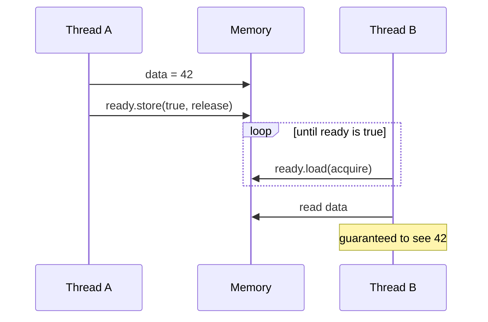

- **release/acquire:** when the acquire load observes the release store (or the applicable release sequence), preceding writes become ordered before the acquiring thread's subsequent reads.
- **relaxed:** atomic access, without that publication guarantee. Useful for independent counters, not automatically for publishing data.
- **seq_cst:** adds a single total order for sequentially consistent atomic operations. A sensible starting point, but it cannot repair an incorrect algorithm.

In the diagram, `ready` is atomic and `data` is written once before publication. The acquire must actually read the published `true`. Without synchronization, the non-atomic accesses to `data` can form a data race, which is undefined behavior, not merely a stale value. Bos chapter 3 is this diagram, expanded over 40 pages, and worth every one.

**A mutex is a flag plus a way to sleep.** A spinlock is `while (atomic_exchange(&locked, 1)) {}`. A real mutex spins briefly then asks the kernel to put the thread to sleep (`futex` on Linux) so it does not burn a core. You build both in week 2 and measure the difference under contention.

**Parallelism is about work distribution.** Eight threads do not give 8x. Amdahl says the serial part caps you. Load imbalance means some threads finish early. Synchronization costs cycles. A job system solves the distribution problem generically:

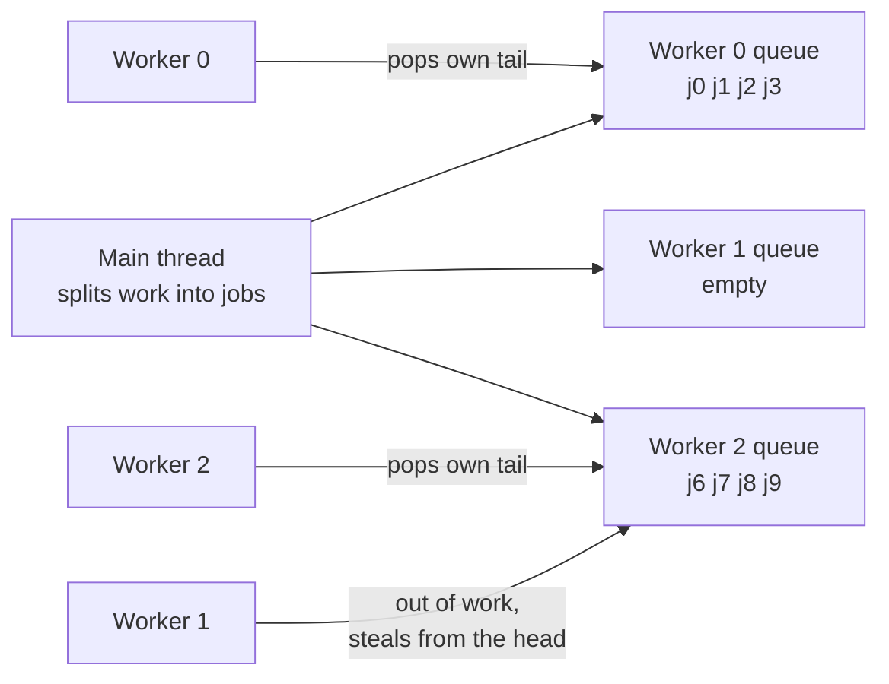

Opposite ends reduce contention on common paths, but empty/last-item transitions still need careful synchronization. Chase-Lev is one work-stealing design, with subtle weak-memory and reclamation requirements. A locked deque is a valid first implementation. Central queues and static partitioning are also useful; choose from measured workload needs.

### Beginner bridge: make the queue correct before removing locks

**Concurrency** means operations overlap in time. **Parallelism** means work actually executes at the same time. A single-core program can have concurrency bugs. A **data race** is a particular unsynchronized conflicting memory access; a broader race condition can exist even when every access is atomic.

Build in this order: mutex plus condition-variable queue, worker pool, static chunking, bounded single-producer/single-consumer (SPSC) ring, then work stealing with one lock per deque. Wait on a condition-variable predicate in a loop because wakeups do not prove work is available. Only replace the locked deque after you can state its owner/thief rules, linearization points and storage lifetime. Multiple-producer/multiple-consumer (MPMC) lock-free queues are stretch work.

Test every job ID completes exactly once, tiny capacities and wraparound, full/empty transitions, waiting parents, idle shutdown and shutdown with pending work. Give tests timeouts so a deadlock is a failure, not an overnight hang. Compare a locked reference with the more complex version on the same workload.

Use [ThreadSanitizer](https://clang.llvm.org/docs/ThreadSanitizer.html) in a separate build from ASan. It detects many executed data races, not lost jobs, every ordering error, deadlock or proof of lock-freedom. Bos supplies the memory-model explanation; do not add a second concurrency course. Read just enough Rust syntax from its introduction to understand examples, and implement them in C with explicit atomics.

### Week by week

| Week | Read | Build |
| --- | --- | --- |
| 1 | Bos chapters 1 to 3, McKenney chapter 3 | Parallel sum with `pthread`. Atomic shared counter, then adjacent per-thread atomic counters versus padded/aligned per-thread atomic counters using the same loop and memory ordering, then per-thread locals. The adjacent/padded pair isolates false sharing. A deliberately racy counter is a bug demonstration, not a valid speed baseline. Plot speedup vs threads. See false sharing in numbers. |
| 2 | Bos chapter 4, McKenney chapter 7 | Spinlock, then a futex-based mutex (Linux), then a ticket lock. Benchmark all three at 1, 4, 16 threads with your phase 4 tester. |
| 3 | Bos chapters 5 to 6, McKenney chapter 5 | Bounded SPSC ring buffer, then a mutex-protected MPMC queue; lock-free MPMC is stretch. Test with ThreadSanitizer (`-fsanitize=thread`). Understand every report it gives you. |
| 4 | CS149 lectures 1 to 6 | Parallel haversine and parallel blocked matmul using plain threads and static chunking. Measure scaling on all your cores. |
| 5 | Bos chapter 8 and 9, the Chase-Lev paper ("Dynamic Circular Work-Stealing Deque", 2005) | **The project:** a work-stealing job system in C. Start with locked deques, a configurable worker count, and a `job_wait` that helps run jobs. A validated weak-memory Chase-Lev implementation is stretch, not an exercise in guessing fences. |
| 6 | CS149 lectures 10 to 12 | Move the matmul and the phase 5 HTTP server's request handling onto the job system. Compare with week 4's static split. |

### Project checklist

- [ ] Speedup plots for every experiment; explain the adjacent/padded counter result even if this hardware shows no dramatic cliff
- [ ] Ring buffer and queue pass exactly-once, wraparound, shutdown and timeout tests, plus ThreadSanitizer stress with zero reports; record that this is testing, not a correctness proof
- [ ] Job system runs the matmul within 10% of the hand-split version and handles uneven jobs better
- [ ] You can explain acquire/release with the diagram above, from memory, and name where your job system needs each

### Traps

- Start with locks or `seq_cst` where appropriate. Weaken an ordering only after writing the required happens-before argument and measuring a reason to change it. Stronger ordering is not a substitute for correct ownership.
- Do not write lock-free code beyond the ring buffer and the deque. Lock-free is a specialty. Locks with short critical sections are the right default for the rest of your career.
- ThreadSanitizer is not optional. A data race that never shows up in tests is still UB.

## Phase 7: Rust, ownership, unsafe, when it helps and when it fights you (8 weeks)

Goal: be productive in Rust for systems work, understand what the borrow checker is actually checking, and know when to reach for `unsafe`. Port two of your C projects, benchmark them against the originals, and form your own opinion about the tradeoff.

**Builds on:** phase 2 (ownership by hand with arenas) and phase 6 (data races). **Adds:** Rust ownership, lifetimes, `unsafe`.

### Why Rust after C and not instead of it

You learned C first so that Rust's rules read as "the compiler enforces what I was already doing by hand with arenas and ownership comments", not as arbitrary restrictions. Bryan Cantrill calls Rust the biggest development in systems software in his career, and he is right about the class of bugs it removes. The handmade school is more skeptical, mostly because the borrow checker fights the data-oriented patterns from phase 4 (many systems mutating shared arrays). Both views are correct about different codebases. After this phase you will know which one you are in.

### Primary resources

- ***The Rust Programming Language***, 2024 edition, free at https://doc.rust-lang.org/book/. Read chapters 1 to 19 fast. You already know the concepts; you are learning the syntax and the rules.
- **Rustlings**, https://github.com/rust-lang/rustlings. Do all of it in week 1 alongside the book.
- ***Learning Rust With Entirely Too Many Linked Lists***, https://rust-unofficial.github.io/too-many-lists/. The best teacher of what the borrow checker rejects and why. You will hate it, then get it.
- **Jon Gjengset, *Rust for Rustaceans*** (2021). Chapters 1 to 5, 8 and 9. The book for people who already program. Ownership in depth, traits, `unsafe`, the memory model.
- **Mara Bos, *Rust Atomics and Locks***, again. You read it for concepts in phase 6. Now do the code in chapters 4, 8 and 9.
- **Jon Gjengset, "Crust of Rust" videos** (YouTube playlist). Pick three: lifetimes, iterators, `Send`/`Sync`. Watch him type; it is the closest thing to pairing with an expert.

### What you are actually learning

**Ownership is a static version of "who frees this."** In C you tracked it in your head and with arena scopes. Rust tracks it in the type system: every value has exactly one owner, a move transfers it, and the value is dropped when the owner goes out of scope.

```
  let a = String::from("hi");
  let mut b = a;                 // ownership moved; a is no longer usable
  let c = &b;
  let d = &mut b;                // rejected because c is used below
  println!("{c} {d}");

  // Move the use of c BEFORE the mutable borrow and this pattern is allowed:
  let mut text = String::from("hi");
  let reader = &text;
  println!("{reader}");          // reader's last use
  let writer = &mut text;
  writer.push('!');
```

For overlapping access to the same data, shared references and an exclusive mutable reference cannot remain usable together. Reference lifetimes often end at last use, not the closing brace. See [TRPL's borrowing examples](https://doc.rust-lang.org/book/ch04-02-references-and-borrowing.html). These rules, together with Rust's other type rules, prevent many invalid accesses in safe code. When systems need overlapping mutable access to one large struct, splitting owned data or borrowing disjoint fields can make the required separation explicit. Indices can also simplify relationships between objects. Rust and DOD agree more than they look.

**Lifetimes are the compiler asking "how long does this reference stay valid."** `fn first<'a>(s: &'a str) -> &'a str` says the returned slice lives no longer than the input. Most of the time you do not write them; elision fills them in. When you do have to, it is because you built something like your phase 2 `Str` type that points into an arena, and the compiler wants proof the arena outlives the view.

**`unsafe` does not turn off the borrow checker.** It unlocks five things: dereferencing raw pointers, calling unsafe functions, accessing mutable statics, implementing unsafe traits, and accessing union fields. Everything you did in C is available; you just mark where. A good Rust codebase has a small `unsafe` core with a safe API on top. Your arena will be exactly that.

**Zero-cost abstraction is a claim you verify in Compiler Explorer.** Iterators, closures, generics and `Option<&T>` compile to the same code as the C loop most of the time. Sometimes they do not. You have the tools from phase 3 to check. Check.

### Beginner bridge: safe containers before unsafe infrastructure

First use `Vec`, slices, `Option`, `Result`, pattern matching and `split_at_mut` in a small port. A `Result` forces you to represent a failure path; `?` propagates it. Neither removes the need to choose what to do at the program boundary. Keep the existing C tests as behavior tests for the port.

A safe arena API must accept an initialized value, for example `alloc<T>(&self, value: T) -> &mut T`. Zeroed bytes are not a valid arbitrary `T`. Before implementing it, write the invariants: proper alignment, disjoint allocations, stable storage, checked arithmetic and no reset while references remain live. Decide whether destructors run; freeing arena memory does not automatically close resources owned by its contents.

Use [bumpalo's allocation and reset contracts](https://docs.rs/bumpalo/latest/bumpalo/struct.Bump.html) as the API comparison. Read the relevant [Rustonomicon safety material](https://doc.rust-lang.org/nomicon/) before writing unsafe code, not after. Run small unsafe-container tests under [Miri](https://github.com/rust-lang/miri) where supported; it is another bug detector, not a proof.

**Checkpoint:** the safe hash-table port passes the C behavior tests before tuning it. Keep unsafe container implementation optional until you can state what safe callers are allowed to do. The raw event-loop port still needs small `unsafe` syscall wrappers; document descriptor ownership, buffer validity and error handling at those boundaries. `Arc<Mutex<T>>` is reasonable when shared ownership and synchronization are genuinely required; prefer simpler ownership when it is enough.

### Week by week

| Week | Read | Build |
| --- | --- | --- |
| 1 | TRPL 1 to 10, Rustlings | Rustlings complete. Then port your phase 1 Hack assembler to Rust. Same tests. |
| 2 | TRPL 11 to 19, Too Many Linked Lists | Too Many Linked Lists all the way through, including the unsafe queue. |
| 3 | Rustaceans 1 to 3 | Stretch: an arena allocator with a safe API (`alloc<T>(&self, value: T) -> &mut T` with a lifetime tied to the arena), explicit destructor policy and tested invariants. Read `bumpalo`'s source afterwards to see how the pros did it. |
| 4 | Rustaceans 4 and 5, Crust of Rust lifetimes and iterators | Port the phase 4 SoA hash table. Use `Vec<u32>` indices, no `Rc<RefCell<>>`. Benchmark against the C one with `criterion`. |
| 5 | Bos 4, 8, 9 in code | Port the locked phase 6 job system. Study `crossbeam-deque` before attempting a lock-free variant; explain its invariants rather than inventing unsafe ordering. |
| 6 to 7 | Rustaceans 8 and 9, Crust of Rust `Send`/`Sync` | **The project:** port the phase 5 event loop and HTTP server. `mio`-style raw `epoll`/`kqueue` via `libc`, no `tokio`. Same `wrk` benchmark. Same 10k connections. |
| 8 | nothing new | Write a 1,000 word comparison: lines of code, bugs found by the compiler, bugs found by tests, benchmark deltas, where `unsafe` ended up. This is the opinion you will carry. |

### Project checklist

- [ ] Rustlings and Too Many Linked Lists complete
- [ ] Arena, hash table, job system and HTTP server ported, each with a benchmark against its C original
- [ ] Every `unsafe` block has a comment stating the invariant it relies on
- [ ] The comparison write-up exists and has numbers in it

### Traps

- **Do not learn `async` in this phase.** `async` Rust is its own subject with its own pitfalls. You built an event loop by hand; that is the more transferable knowledge. Learn Tokio when a project needs it, including cancellation and resource-lifetime behavior rather than just its syntax.
- **Do not add shared ownership without a reason.** First try separate owned data and explicit borrowing. Use `Rc<RefCell<T>>` or `Arc<Mutex<T>>` when their actual contracts match the problem.
- **Do not write unsafe containers without reading their safety requirements.** Use the relevant Rustonomicon sections now; leave unrelated advanced material for phase 11.

## Phase 8: GPU programming, CUDA, matmul from naive to tensor cores (10 weeks)

Goal: write CUDA kernels that reach a large fraction of the hardware's peak, know why the naive version is 100x slower, and be able to read a state-of-the-art matmul or attention kernel. Then understand what Triton and `torch.compile` are doing on your behalf. Your ML background means you already know what these kernels are for. Now you learn what they are.

**Builds on:** phase 4 (bandwidth, SIMD) and phase 6 (splitting work across cores). **Adds:** CUDA, the GPU memory hierarchy, matmul tiling.

### The Mac problem, and your NVIDIA laptop

There is no CUDA on macOS. Do not try to learn GPU programming on Metal alone: the concepts transfer, but this phase's examples and profiling tools (`nsight`, `ncu`) target CUDA. Do this phase on your NVIDIA gaming laptop. Dual-boot Linux on it, or use WSL2 on Windows, then install the CUDA Toolkit and Nsight Compute. Native Linux gives less trouble. On WSL2 you have to allow GPU performance counters in the Windows NVIDIA Control Panel before `ncu` can profile anything. Check the card with `nvidia-smi` first: RTX 20-series or newer has the tensor cores that weeks 7 and 8 need. Laptop GPUs run lower clocks than desktop cards and throttle when hot, so plug the laptop in and compare your kernels against cuBLAS on the same laptop, never against numbers from blog posts. Rent a data-center GPU for an evening only if you want to try the Hopper features from Gordić's article in week 10. Use Metal on the Mac in week 9 to see that the ideas are the same.

### Primary resources

- ***Programming Massively Parallel Processors***, Hwu, Kirk and El Hajj. Use the 4th edition if you have it; the 5th edition is also listed by the publisher. Match chapters by topic rather than assuming identical numbering: programming model, memory, scheduling, convolution, reduction, scan, histogram and matmul. These are the textbook selections, not an instruction to finish every chapter.
- **Simon Boehm, "How to Optimize a CUDA Matmul Kernel for cuBLAS-like Performance: a Worklog"**, https://siboehm.com/articles/22/CUDA-MMM. Ten kernels, naive to 95% of cuBLAS, every step measured and explained. Weeks 4 to 6 follow this article kernel by kernel.
- **GPU MODE lectures**, https://www.gpumode.com/lectures, and the Discord. Lectures 1 to 4 (profiling, PMPP), 8 (CUDA performance checklist), 14 (Triton practitioner's guide), the Flash Attention lectures. The Discord is where kernel people actually talk.
- **Sasha Rush, GPU Puzzles**, https://github.com/srush/GPU-Puzzles, and **Triton Puzzles**, https://github.com/gpu-mode/Triton-Puzzles. Do GPU Puzzles in week 1; they are the fastest way to internalize thread indexing.
- **Horace He, "Making Deep Learning Go Brrrr From First Principles"**, https://horace.io/brrr\_intro.html. Read in week 1. Compute-bound vs memory-bound vs overhead-bound is the whole mental model.
- **NVIDIA CUDA C++ Programming Guide**, https://docs.nvidia.com/cuda/cuda-programming-guide/. Reference. Sections on the programming model, memory hierarchy, and the "performance guidelines" chapter.
- **Andrej Karpathy, llm.c**, https://github.com/karpathy/llm.c. Read the CUDA kernels in weeks 8 to 10. A full GPT-2 training loop in plain CUDA with no framework, written by someone who explains as he goes.
- **Aleksa Gordić, "Inside NVIDIA GPUs: Anatomy of high performance matmul kernels"** (2025), https://www.aleksagordic.com/blog/matmul. Week 10 reading, once Boehm's kernels make sense: what Hopper and Blackwell add on top.
- **NVIDIA CUDA C++ Best Practices Guide**, https://docs.nvidia.com/cuda/cuda-c-best-practices-guide/. Read the memory optimization and execution configuration chapters alongside week 2.
- **NVIDIA cuda-samples**, https://github.com/NVIDIA/cuda-samples. Build it on the laptop in week 1. `deviceQuery` prints your SM count and memory size, `bandwidthTest` prints the bandwidth your kernels are measured against.
- **LeetGPU**, https://leetgpu.com. Short CUDA problems with a judge. Use it for extra reps in weeks 1 to 3 after GPU Puzzles.
- **PTX and SASS, the GPU's assembly.** `nvcc -ptx` shows the virtual ISA and `cuobjdump -sass` shows the real machine code. Compiler Explorer does both with NVCC. In week 5, read the SASS of your tiled matmul the same way you read x86-64 in phase 3.

### What you are actually learning

**A GPU is a throughput machine: thousands of simple cores, hidden latency, and a hierarchy you must respect.**

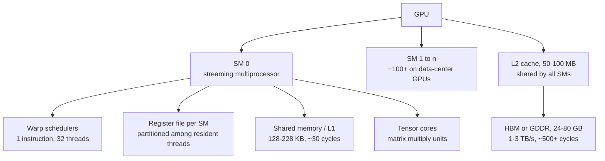

Your laptop card has fewer SMs and GDDR instead of HBM. `deviceQuery` prints its real numbers. Your program maps onto that hardware like this:

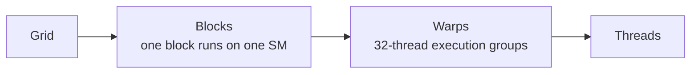

Threads in a block cooperate through shared memory. Divergent paths can reduce warp efficiency, but implicit lockstep is not a synchronization guarantee on modern GPUs. Use block barriers at shared-memory producer/consumer boundaries and synchronized warp intrinsics with valid participation masks. For these kernels, all non-exited threads in a block must reach the corresponding `__syncthreads()` uniformly; it is not a barrier for an arbitrary subset. Ordinary blocks cannot assume an execution order.

This is the phase 4 memory hierarchy again with different numbers and one new level you control by hand: shared memory. The lesson is the same. Bandwidth is the limit; locality is the lever.

**Coalescing: neighboring lanes should usually access neighboring elements.** Aligned contiguous accesses touch fewer memory sectors than widely strided accesses. The exact number of transactions depends on element width, alignment, caches and architecture; it is not universally one versus 32. Profile both layouts. This is the SoA argument from phase 4 applied to a warp.

**Matmul tiling is the whole course in one kernel.** Naive: every thread computes one output element and reads a full row and column from global memory, so every input is read N times. Tiled: a block loads a tile of A and a tile of B into shared memory once, every thread in the block reuses it, and global traffic drops by the tile size.

```
  C = A x B, computing one BM x BN tile of C per block:

        for k in 0..K step BK:
           load A[bm, k:k+BK] tile  ──► shared memory  (once per block, coalesced)
           load B[k:k+BK, bn] tile  ──► shared memory
           __syncthreads()
           each thread: for kk in 0..BK: acc[tm][tn] += As[..][kk] * Bs[kk][..]
           __syncthreads()

  Boehm's ladder:  naive 1.3%  → coalesced 8%  → shared mem 12%  → 1D tile 36%
                   → 2D tile 68% → vectorized loads 80% → autotuned + warptiling 94%
                   (of cuBLAS, fp32, RTX A6000)
```

After fp32 you move to tensor cores (`wmma` or `mma.sync`) for fp16/bf16, and the same tiling structure gets a hardware matrix unit at the bottom.

**Arithmetic intensity tells you the ceiling before you write a line.** FLOPs per byte moved. A matmul has O(N) intensity and can be compute-bound. A simple elementwise arithmetic operation often has low intensity and is bandwidth-bound; a tiny launch may be overhead-bound and expensive math may be compute-bound. Fusion can reduce traffic and launch overhead, but can also increase register pressure. This is why Flash Attention exists (never write the N² attention matrix to HBM) and why `torch.compile` fuses elementwise chains. Horace He's article and the roofline model from PMPP chapter 5 are the tools.

**Triton is tiling with the bookkeeping automated.** You write the tile-level program in Python, Triton picks the thread mapping, shared memory use and vectorization. Learn it after CUDA, in one week, and you will know what it is hiding.

### Beginner bridge: shape, synchronization and numerical error

Learn only the CUDA C++ syntax this project needs: references, template parameters for tile sizes, `__global__`, `__device__`, and the `<<<grid, block>>>` launch. Write a CPU reference first:

```text
A is M x K, B is K x N, C is M x N
row-major A[row, col] = A[row * K + col]
C[i, j] = sum over k of A[i, k] * B[k, j]
```

Test rectangular shapes and sizes not divisible by a tile, not just square powers of two. Check host/device allocation sizes and every CUDA API result. A launch is asynchronous: check launch errors and synchronize at deliberate validation boundaries to surface execution errors. Time kernels with CUDA events after warmup; report transfers separately.

Use [Compute Sanitizer](https://docs.nvidia.com/cuda/compute-sanitizer/) for device memory and synchronization checks. Neither host ASan nor a visually plausible output validates a kernel. For comparisons, match dtype, accumulation mode, layout, dimensions and cuBLAS/TF32 settings. Specify `abs(actual - expected) <= atol + rtol * abs(expected)` with tolerances justified for the operation and precision; a universal `1e-3` is not enough.

Before attention, implement stable row softmax:

```text
m = max(x)
p[i] = exp(x[i] - m) / sum_j exp(x[j] - m)
```

Then derive the online update used when a row arrives in tiles: rescale the old sum and weighted output when the running maximum changes. This is why reading a FlashAttention kernel without understanding its normalization is difficult. Include extreme inputs and define the all-masked-row behavior. Attention is stretch until reductions and tiled matmul are correct.

Check your GPU's compute capability against the guide before choosing tensor-core dtypes or architecture-specific instructions. Book/blog percentages are observations from their hardware, not promises for your laptop.

### Week by week

| Week | Read | Build (on your NVIDIA laptop) |
| --- | --- | --- |
| 1 | PMPP 1 to 3, Horace He article | Build cuda-samples and run deviceQuery and bandwidthTest to get your card's numbers. GPU Puzzles, all of them. Then a vector add, a SAXPY, a timing harness with CUDA events. |
| 2 | PMPP 4 to 6, GPU MODE lecture 1 and 8 | Memory bandwidth probe: measure achieved GB/s for coalesced vs strided vs random. Learn `ncu` (Nsight Compute) and read its memory chart. |
| 3 | PMPP 10 to 12 | Reduction (sum), prefix scan, histogram. Each one naive, then with shared memory, then with warp shuffles. Measure each step. |
| 4 to 6 | Boehm's worklog, PMPP matmul chapter | **The project, part 1:** Boehm's ten fp32 matmul kernels, written by you, each profiled with `ncu`. Reach 80% of cuBLAS. Keep the numbers. |
| 7 | PMPP on tensor cores, CUDA guide on `wmma` | fp16 matmul on tensor cores. Then compare to `cublasGemmEx`. |
| 8 | GPU MODE Flash Attention lectures, the Flash Attention 2 paper | **The project, part 2:** fused softmax, then a minimal Flash Attention forward kernel. Correctness against PyTorch, then speed. |
| 9 | GPU MODE lecture 14, Triton tutorials 1 to 3 | Rewrite the matmul and fused softmax in Triton. Compare against your CUDA. On the Mac: the same tiled matmul in Metal Shading Language, to see the model transfer. |
| 10 | llm.c CUDA kernels, Gordić matmul article | Read `llm.c`'s `matmul_forward`, `attention_forward`, `layernorm_forward` and the backward kernels. Write up how each maps to what you built. |

### Project checklist

- [ ] Correct tiled FP32 matmul with a per-kernel throughput/bottleneck table; 80% of matched-mode cuBLAS is stretch
- [ ] Stretch: tensor-core matmul running and verified for supported shapes and precision
- [ ] Stretch: attention forward matches a reference under a stated absolute/relative error policy; report speed against a clearly identified baseline
- [ ] Triton versions of both, with a paragraph on what Triton did for you
- [ ] You can look at an `ncu` report and say memory-bound, compute-bound, or latency-bound, and why

### Traps

- Do not start with Triton or PyTorch custom ops. You will learn the API and not the machine.
- Do not skip `ncu`. A kernel you cannot profile is a kernel you cannot fix.
- Use cuBLAS as a measured reference, not a required score. Explain your bottleneck before chasing the next percentage point.

## Phase 9: compilers, interpreters, bytecode VMs, Lua (10 weeks)

Goal: build a complete bytecode compiler and virtual machine in C, with a garbage collector, closures and a hand-written scanner and parser. Then read the real thing: the Lua source, which is the best small language implementation ever written, and embed it in a C program. After this, "how does the language do that" is a question you answer by reading the source.

**Builds on:** phase 1 (the Hack VM idea) and phase 2 (C, arenas, hash tables). **Adds:** scanners, parsers, bytecode VMs, garbage collection.

### Primary resources

- **Bob Nystrom, *Crafting Interpreters***, free at https://craftinginterpreters.com. First read [The Lox Language](https://craftinginterpreters.com/the-lox-language.html) so you know the behavior you are implementing. Then build part 3 ("A Bytecode Virtual Machine", chapters 14 to 30), in C. You can skip implementing part 2's Java tree-walker; revisit a concept there only when part 3 refers back to it. Every chapter ends with working code, and the book explains every line. Do not copy, type.
- **The Lua source**, https://www.lua.org, version 5.5 (released December 2025). About 30,000 lines of clean C. Read in this order: `lopcodes.h`, `lvm.c`, `lobject.h`, `lgc.c`, `lparser.c`, `lapi.c`. Lua is what Crafting Interpreters' clox grows up to be.
- **Roberto Ierusalimschy, *Programming in Lua***, 4th edition (2016, covers 5.3; the language has changed little). Parts 1 and 4 (the language, and the C API). The 1st edition is free online at https://www.lua.org/pil/, but uses an older language version. For current syntax and the C API, use the [Lua 5.5 reference manual](https://www.lua.org/manual/5.5/). Build the manual, headers and runtime from the same release.
- **"The Implementation of Lua 5.0"** (Ierusalimschy, de Figueiredo, Celes, 2005). A 15-page paper on the register VM, tables, closures and coroutines. Read it between clox and the Lua source.
- **Optional, for the parsing side:** the "Pratt parsing" chapter of Crafting Interpreters is enough. If you want more, Matklad's "Simple but Powerful Pratt Parsing" blog post (2020) is the one to read.

### Why Lua is in this roadmap

You asked for it, and it earns its place. Lua is the language that game engines, Neovim, Redis, nginx and Roblox embed. It is small enough to read entirely, fast for an interpreter, and its C API is the model for how a scripting language should talk to a host. Learning to embed Lua teaches you how to design a boundary between a fast core and a flexible layer, which is a skill you use whether or not you use Lua.

### What you are actually learning

**A language implementation is a pipeline of small transformations.**

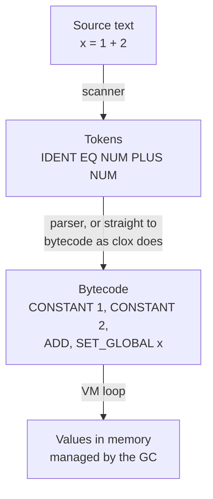

The VM is one loop:

```c
// Sketch: assume opcode bounds, stack depth and numeric types were checked.
for (;;) {
    switch (*ip++) {
    case OP_ADD: {
        double right = pop_number();
        double left = pop_number();
        push_number(left + right);
        break;
    }
    /* Other opcodes include an explicit return/halt path. */
    }
}
```

This is the dispatch idea used by many bytecode interpreters, not their whole implementation. Runtime services, optimized dispatch and JIT compilation can change the execution path. The differences are in the details: stack VM (clox, CPython) vs register VM (Lua), tracing vs reference counting, and how values are represented.

**The VM loop is your phase 1 Hack CPU in software.** Fetch opcode, decode, execute. The `ip` is the program counter. The stack is the register file. Your Hack emulator from phase 1 was already an interpreter. This is why you built it.

**Value representation decides speed.** A dynamically typed value needs a tag plus a payload. clox uses a 16-byte tagged union, then NaN-boxing to squeeze it into 8 bytes. Lua uses a tagged union with a 64-bit payload. The choice affects every instruction and every byte of cache. Phase 4 thinking, applied to language design.

**Garbage collection is a graph traversal with a stop-the-world problem.** Mark-and-sweep: start from the roots (the stack, globals), mark everything reachable, free everything else. Clox chapter 26 has you write it. Lua's is incremental and generational, and reading `lgc.c` after writing clox's collector is the right order.

**Closures are functions plus captured variables, and capturing is the hard part.** A local variable lives on the stack until the function returns. A closure that outlives its enclosing function needs that variable moved to the heap. Lua's "upvalues" and clox's "open and closed upvalues" (chapter 25) are the same clever trick. It is the trickiest chapter in the book, and the most satisfying.

**Embedding needs a lifetime boundary.** Lua's C API uses stack values and registry references to keep objects reachable by its collector. It also exposes pointers whose validity depends on the API contract; storing a C pointer does not root a Lua object. Track the stack height and lifetime of every borrowed value.

### Beginner bridge: trace one expression end to end

A grammar describes valid structure; semantics describe what that structure means. Precedence says multiplication binds more tightly than addition. Associativity decides how equal-precedence operators group. Trace this before adding variables:

```text
source:   1 + 2 * 3
parse:    1 + (2 * 3)
bytecode: CONST 1, CONST 2, CONST 3, MULTIPLY, ADD, RETURN
stack:    [1] -> [1,2] -> [1,2,3] -> [1,6] -> [7]
```

Now trace `8 - 3 - 1`; popping right before left matters. Add disassembly output and tests for syntax errors, precedence, scope and runtime type errors. When GC arrives, force frequent collections in debug mode and test closures after the enclosing function has returned. Objects temporarily held only in C locals may need explicit roots.

Before embedding into the HTTP server, write a 50-line single-threaded host that calls a Lua function, gets a result and handles a script error with `lua_pcall`. Draw the Lua stack before and after the call. Do not let a Lua error jump through unrelated host cleanup. Give each state a clear thread owner, or serialize access. For reload, compile and validate the new code before replacing the working handler; define what happens to persistent state and old closures.

### Week by week

| Week | Read | Build |
| --- | --- | --- |
| 1 | Crafting Interpreters 14 to 17 | clox: chunks, VM loop, scanner, Pratt parser through arithmetic expressions. |
| 2 | Chapters 18 to 21 | Values, strings, hash table (you have one from phase 2; compare), globals. |
| 3 | Chapters 22 to 24 | Locals, jumps, control flow, functions and calls. |
| 4 | Chapters 25 to 26 | Closures with upvalues. Then the garbage collector. Run under ASan the whole time. |
| 5 | Chapters 27 to 30 | Classes, methods, superclasses (do them even though we do not love them; the dispatch mechanics matter). Chapter 30's optimization pass: NaN-boxing and a faster hash. Benchmark with your phase 4 tester. |
| 6 | "Implementation of Lua 5.0" paper, PiL part 1 | Write 500 lines of Lua: a tokenizer for your phase 2 JSON format, in Lua. Feel the language. |
| 7 | `lopcodes.h`, `lvm.c` | Read the Lua VM loop. Write a table mapping each clox opcode to its Lua equivalent and note what the register machine saves. |
| 8 | `lgc.c`, `lobject.h`, `ltable.c` | Read the GC and the table implementation. Lua's table (array part plus hash part) is a phase 4 lesson in itself. |
| 9 | PiL part 4 (the C API), `lapi.c` | **The project, part 2:** embed Lua in your phase 5 HTTP server. Route handlers in Lua, request and response objects exposed via the C API, hot reload on file change. |
| 10 | nothing new | Stretch: extend clox with one small feature. Coroutines or a register-based instruction set are substantial follow-on projects, not required one-week additions. Write up the design. |

### Project checklist

- [ ] clox passes the book's test suite (https://github.com/munificent/craftinginterpreters, `test/` directory)
- [ ] clox runs the book's benchmarks under ASan and under `-O2` with numbers recorded
- [ ] Lua embedded in your server, handlers hot-reload, no leaks under Valgrind after 10k requests
- [ ] Your clox-to-Lua opcode table and a paragraph on why register VMs execute fewer instructions

### Traps

- Do not use a parser generator. The point is to write the parser.
- Do not read LLVM or write a native code backend now. That is a separate 6-month path. If you want it later, "Engineering a Compiler" (Cooper and Torczon, 3rd ed.) is the book.
- Do not replace clox's hash table with yours in week 2. Do it in week 5 as an experiment, with numbers.

## Phase 10: graphics and real-time systems, the handmade way (10 weeks)

Goal: build an interactive program from the pixels up. A platform layer that owns the window, input, audio and timing, a software renderer that draws triangles into a buffer you allocated, and a game loop that hits 60 frames per second without dropping one. No engine, no framework. This is where the whole school's philosophy becomes muscle memory, and it is the most fun phase.

**Builds on:** phase 2 (arenas), phase 4 (SIMD) and phase 6 (the job system). **Adds:** platform layers, game loops, software rendering.

### Why a game-style program and not another server

A game usually has a soft real-time frame budget, about 16.67 ms at 60 Hz. It touches memory, threads, SIMD, I/O and the OS, and shows performance problems on screen. A general-purpose desktop OS does not guarantee every frame meets that budget. It is the tightest feedback loop in programming. That is why Muratori, Blow and Acton all come from games, and why their advice generalizes.

### Primary resources

- **Casey Muratori, Handmade Hero**, episode guide at https://guide.handmadehero.org. Use days 1 to 60 as a menu for the early platform/game work, not mandatory viewing before you build. The series continues into deeper rendering much later; consult the episode guide by topic. Casey writes a full game from scratch in C-style C++ on stream, explaining every decision. Watch at 1.5x with the code open, and rewrite it for your platform (macOS or SDL3) rather than copying his Win32 code. Use the weekly episode ranges as orientation and select the episodes relevant to the code you are building.
- **Peter Shirley, *Ray Tracing in One Weekend***, https://raytracing.github.io. Free. Book 1 in week 5, book 2 if you like it. Ray tracing is the cleanest possible introduction to how light, cameras and geometry become pixels.
- **SDL3** (stable since January 2025, https://wiki.libsdl.org/SDL3). Use it for the window, input and audio so you can spend your time on the renderer. Read its source when you want to know what a platform layer really does per OS.
- **Learn OpenGL**, https://learnopengl.com, chapters "Getting started" only, in week 9, to see what the GPU pipeline does with the triangles you rasterized by hand in week 4.
- **Talks:** Jonathan Blow, "How to program independent games" (2011, on doing the simplest thing). Casey Muratori, "Semantic Compression" (blog, https://caseymuratori.com/blog\_0015). Both are about how to structure this project.

### What you are actually learning

**A real-time program is a loop with a budget.**

```
  while (running) {
      t0 = now();
      poll input                        ─┐
      update simulation (dt)             │  must finish in 16.67 ms for 60 Hz
      render into the backbuffer         │  (or 6.9 ms for 144 Hz)
      present backbuffer to the screen  ─┘
      sleep until t0 + frame_budget;    // or vsync does it for you
  }

  memory: one big arena allocated at startup, split into permanent + transient.
          transient is reset every frame. no malloc in the loop, ever.
```

This is the arena idea from phase 2 applied to a whole program. It removes one source of unpredictable work; it does not prevent stalls from I/O, page faults, scheduling or GPU synchronization.

**A platform layer separates "what the OS does" from "what the program does."** The OS side opens a window, delivers input events, hands you an audio buffer to fill, and shows a pixel buffer. The program side has an explicit boundary: `(input, memory, dt) -> (updated memory, pixels, sound)`. Mutating game memory is not mathematical purity, but keeping OS access outside this boundary makes replay and testing easier. Casey's insight is that the program should be the callee, not the caller: the platform layer calls `GameUpdateAndRender` once per frame. This makes the program testable, hot-reloadable (day 21) and portable.

**A pixel buffer is a 2D array of 32-bit integers and everything else is math on top.**

```
  // Schematic packed RGB example; validate dimensions before allocating.
  uint32_t *pixels = arena_new(perm, uint32_t, pixel_count);

  pixels[y * width + x] = packed_color; // only for a matching packed format

  a rectangle:  two loops
  a line:       Bresenham, 20 lines of integer math
  a triangle:   for each pixel in the bounding box, three edge tests,
                if inside: interpolate color/texture by barycentric weights
  a 3D scene:   project each vertex by a 4x4 matrix, then draw triangles
```

By week 4 you have written a rasterizer, and the GPU pipeline in week 9 (vertex shader, rasterizer, fragment shader) is just your code with a name for each stage.

**Performance is visible here.** A 1920x1080 frame is 2 million pixels. Fill it with a scalar loop at 1 ns per pixel and you spend 2 ms. Add a texture lookup per pixel with a cache miss and you spend 200 ms. Phase 4 (SIMD, cache) and phase 6 (job system, one tile per core) are how you get it back. Handmade Hero days 110 to 130 do exactly this if you want to go further.

### Beginner bridge: the math between a triangle and a cube

Reuse LearnOpenGL's [Transformations](https://learnopengl.com/Getting-started/Transformations) and [Coordinate Systems](https://learnopengl.com/Getting-started/Coordinate-Systems) before week 4, rather than adding a linear-algebra course. Learn vectors, dot/cross products, matrix multiplication order and homogeneous coordinates only as needed for the renderer.

```text
object vertex -> model matrix -> world position
              -> view matrix -> camera-relative position
              -> projection matrix -> clip (x,y,z,w)
              -> clip against view volume
              -> divide by w -> normalized coordinates
              -> viewport -> pixel coordinates
```

Choose handedness, matrix convention and depth range once and write them down. Clip before dividing by `w`; triangles crossing the near plane must not explode across the screen. For a triangle, edge functions determine coverage and barycentric weights interpolate values. Perspective-correct texture mapping interpolates `u/w`, `v/w` and `1/w`, then divides; ordinary screen-space interpolation visibly warps a tilted checkerboard.

For implementing edge tests, barycentric coordinates and perspective-correct interpolation, read only the relevant sections of [Scratchapixel's practical rasterization lesson](https://www.scratchapixel.com/lessons/3d-basic-rendering/rasterization-practical-implementation/rasterization-practical-implementation.html). LearnOpenGL shows the coordinate transforms; this fills the software-rasterizer implementation gap.

For clipping, process the triangle as a polygon against one plane at a time. Let signed plane distance `d >= 0` mean inside. For each directed edge `a -> b`: inside/inside emits `b`; inside/outside emits the intersection; outside/inside emits the intersection then `b`; outside/outside emits nothing. A crossing has `t = d(a) / (d(a) - d(b))`; interpolate the clip-space vertex and its attributes at `t`. Repeat for the chosen view-volume planes, then triangulate the remaining polygon. Test triangles wholly inside, wholly outside and crossing the near plane before perspective division.

**Build gates:** draw one 2D triangle, two triangles sharing an edge without cracks, overlapping triangles with depth testing, then a clipped cube. Start scalar at a low resolution. Use the scalar output as the reference for SIMD and tiles; do not debug projection, concurrency and vectorization in the same change.

A display buffer also has a pixel format, alpha convention and **pitch** (bytes between row starts). `y * width + x` applies only to a tightly packed matching buffer. For audio, a frame contains one sample per channel; sample rate counts frames per second. Keep allocation, blocking I/O and long locks out of an audio callback. These are the platform contracts to check in the existing SDL3 docs.

### Week by week

| Week | Watch or read | Build |
| --- | --- | --- |
| 1 | Handmade Hero days 1 to 10 | Platform layer on SDL3: window, pixel buffer, keyboard and gamepad input, a moving gradient at 60 Hz with frame timing printed. |
| 2 | Days 11 to 25 | Audio (a sine wave you can change pitch with keys), the permanent/transient memory arenas, input recording and playback (day 23, an amazing debugging tool), hot code reload of the game DLL. |
| 3 | Days 26 to 40 | Rectangles, bitmaps, sprite blitting with alpha, a tile map, a character that walks. |
| 4 | LearnOpenGL Transformations and Coordinate Systems; the bridge above | **Rasterizer:** lines, then filled triangles with edge functions, then a perspective-projected spinning cube with a depth buffer. |
| 5 | Ray Tracing in One Weekend, book 1 | Complete the book in C. Output a PPM. Then multithread it with your phase 6 job system. |
| 6 | Days 41 to 60 | Entity system the Handmade way: a flat array of entities, no inheritance, `switch` on a type tag. Collision, a camera, a debug overlay with per-frame timings. |
| 7 | Semantic Compression post | Refactor pass: pull out only what has been written three times. Compare your code size against week 3. |
| 8 | nothing new | Optimize the renderer: SIMD fill, tile-based rendering across the job system. Show a frame-time graph on screen. Target 1080p at 60 Hz with a full-screen textured scene, in software. |
| 9 | Learn OpenGL, Getting Started | Port only the presentation step to OpenGL: upload your backbuffer as a texture and draw a quad. Then draw your cube with a shader and compare. |
| 10 | nothing new | Make something. A small playable thing using all of it. Ship a build that runs on someone else's Mac. |

### Project checklist

- [ ] Platform layer with input, audio, timing, hot reload and input playback
- [ ] Correct textured, depth-tested scalar scene, including near-plane clipping; 1080p60 SIMD/multicore rendering is stretch
- [ ] Multithreaded ray tracer producing book 1's final image
- [ ] A playable build with frame-time median, tail latency and stalls recorded on a stated machine

### Traps

- Do not use an engine, and do not use an ECS library. Flat arrays and a `switch` are the ECS.
- Do not spend the phase on OpenGL or Vulkan. One week at the end is enough to see the mapping. Vulkan is a 3-month topic; take it only if you go into graphics professionally.
- Do not watch Handmade Hero without typing. Sixty hours of watching teaches nothing.

## Phase 10b: game engines and game dev, ship real games (10 weeks)

Goal: turn the phase 10 platform layer and renderer into a small engine, and ship two games with it on itch.io: a 2D action game and a small 3D game. The engine moves rendering to the GPU, loads real assets, runs gameplay at a fixed timestep, plays sound, scripts gameplay in Lua and has in-game debug tools. Every system gets built because a game needs it, never ahead of time.

**Builds on:** phase 10 (platform layer, renderer), phase 9 (embedding Lua) and phase 8 (the GPU model). **Adds:** GPU rendering, physics, assets, tools, shipping.

### Why build games, not an engine

An engine written without a game turns into a pile of features nobody uses. Write the game and pull the engine out of it, the way Handmade Hero does. The rule for this phase: a system goes into the engine only after game code needed it, and it moves out of game code only when the second game needs it too.

Everything a game needs, at a glance. Each branch becomes an engine system during this phase:

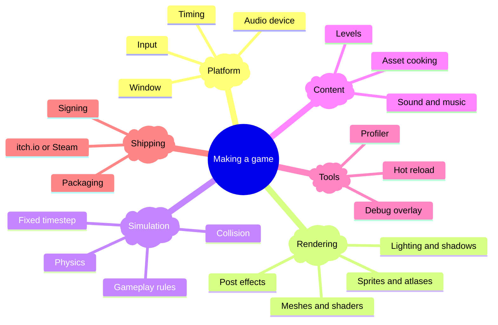

### Primary resources

- **Robert Nystrom, *Game Programming Patterns*,** free at https://gameprogrammingpatterns.com. Read Game Loop, Update Method, Double Buffer, Component, Event Queue, Object Pool, Spatial Partition and Data Locality. The chapters are short and the C++ examples port to C directly.
- **Jason Gregory, *Game Engine Architecture*,** 3rd edition (2018). It describes what each subsystem does in a shipped AAA engine. Read the chapters on engine support systems, the game loop, resources and the file system, collision and rigid bodies, and gameplay foundation systems. Use it to look things up, not cover to cover.
- **Glenn Fiedler, "Fix Your Timestep!"**, https://gafferongames.com/post/fix\_your\_timestep/. Read it in week 1. The rest of his site covers networked physics if you want multiplayer later.
- **SDL3 GPU API**, https://wiki.libsdl.org/SDL3/CategoryGPU. One API over Metal, Vulkan and Direct3D 12, so the same renderer runs on your Mac and your NVIDIA laptop. The repo https://github.com/TheSpydog/SDL\_gpu\_examples shows each feature in one file. SDL\_shadercross converts one shader source to every backend.
- **Single-file C libraries:** stb\_image for textures, cgltf (https://github.com/jkuhlmann/cgltf) for glTF models, miniaudio (https://miniaud.io) for mixing and playback, Dear ImGui (https://github.com/ocornut/imgui, through cimgui from C) for debug UI, Tracy (https://github.com/wolfpld/tracy) for frame profiling. Use them and spend your time on the parts that are yours.
- **Physics:** Christer Ericson, *Real-Time Collision Detection* (2004), chapters on bounding volumes and spatial partitioning. Then read Box2D v3 (https://github.com/erincatto/box2d), a production 2D physics engine written in C, and Erin Catto's solver talks at https://box2d.org/publications/.
- **Learn OpenGL**, the "Lighting" chapters and "Shadow Mapping", for the 3D lighting math. The lighting equations transfer, but projection depth and coordinate conventions must match SDL3 GPU rather than being copied unchanged.
- **Game jams:** Ludum Dare (https://ldjam.com) and the jams listed at https://itch.io/jams. A 48-hour jam shows you what your engine is missing faster than anything else.

### What you are learning

**An engine is layers, and each layer only calls down.**

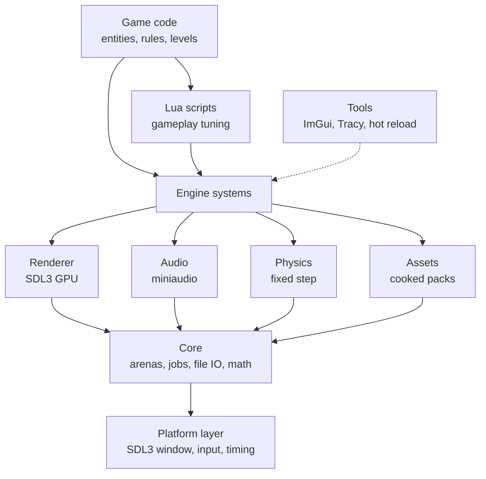

Game code never calls SDL directly. Porting to a new platform touches only the bottom layer.

**Gameplay runs at a fixed timestep.** Rendering runs as fast as the display allows. Physics and gameplay advance in fixed steps of 1/60 or 1/120 s, so a slow frame never changes how a jump feels. The renderer draws between the last two simulation states:

```c
double accumulator = 0.0;
double previous_time = now_seconds();
while (running) {
    double current_time = now_seconds();
    double frame_time = current_time - previous_time;
    if (frame_time > 0.25) frame_time = 0.25;  // after a stall, don't simulate forever to catch up
    previous_time = current_time;
    accumulator += frame_time;

    poll_input(&input);
    while (accumulator >= FIXED_DT) {
        previous_state = state;
        simulate(&state, &input, FIXED_DT);
        accumulator -= FIXED_DT;
    }
    double alpha = accumulator / FIXED_DT;
    render(&previous_state, &state, alpha);
}
```

**Entities are indices, not pointers.** Keep entities in flat arrays and hand out handles with an index and a generation. A handle to a destroyed entity fails the generation check instead of pointing at reused memory. This is the pool from phase 2, and many shipped engines refer to objects this way.

```c
typedef struct { uint32_t index; uint32_t generation; } EntityHandle;

// World owns capacity slots; each Entity has alive and generation fields.
Entity *entity_get(World *world, EntityHandle handle) {
    if (handle.index >= world->capacity) return NULL;
    Entity *entity = &world->entities[handle.index];
    if (!entity->alive || entity->generation != handle.generation) return NULL;
    return entity;
}
```

**The GPU renderer draws batches.** Every draw call has a fixed CPU cost. Thousands of sprites go into one call: pack them into a texture atlas, write all their quads into one vertex buffer per frame, draw once. A 3D frame is a short list of passes:

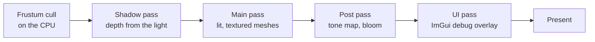

The diagram is a frame workflow: CPU culling and presentation are not render passes themselves. Inspect the GPU passes with a frame capture: Xcode's Metal debugger on the Mac, RenderDoc on the NVIDIA laptop.

**Assets are cooked offline.** Source files (.png, .gltf, .wav) are for editing. A cook step you write converts them once into the bytes the engine wants: GPU-ready textures, vertex buffers and decoded audio, all in one packed file. At runtime the loader validates the pack version, sizes, offsets and arithmetic before using its contents. It avoids source-format parsing, not all validation. Use defined byte order and field widths rather than dumping native structs.

**Collision is broadphase, then narrowphase.** The broadphase finds pairs that might touch, with a uniform grid or sorted bounding boxes. The narrowphase tests those pairs exactly and produces contacts. For a 2D platformer, AABBs and swept tests are enough and you write them yourself. For stacking and joints, use Box2D and read its solver.

**Game feel is tuning, and tuning needs fast iteration.** Jump height, coyote time, input buffering, screen shake and hit-stop decide whether a game is fun. They are numbers you will change hundreds of times. Put them in Lua or a hot-reloaded file and in an ImGui panel, so a change takes a second and no restart. Jan Willem Nijman's talk "The art of screenshake" (2013) lists the cheap effects that matter most.

**Shipping takes real work.** For smooth public macOS distribution, plan a .app bundle signed with Developer ID and notarized; consult Apple's current requirements and fees. Local/test distribution has other options, with more friction for recipients. The Windows build, settings, crash log and itch.io page also need testing on another machine. Budget a full week for it the first time.

### Beginner bridge: frame lifetime is not resource lifetime

The fixed-step sketch above assumes `state` is a small value snapshot, not a shallow copy of a pointer-owning world. Interpolate only the render state you need. Distinguish held buttons from press/release events: consume a jump press once, not on every catch-up tick. Set a maximum catch-up count and record when you drop accumulated time. A fixed timestep helps reproducibility but does not guarantee deterministic floating-point or threaded execution.

For handles, mark freed slots dead and change their generation before reuse. Define a generation-wrap policy, such as retiring the slot before its counter wraps. Test stale handles and invalid indices. Generation checks do not protect a raw pointer kept after the array moves.

On the GPU, submission is not completion:

```text
CPU writes upload data -> records commands -> submits
                                             GPU reads later -> completes
CPU must not overwrite/free data still referenced by unfinished GPU work
```

Read SDL3 GPU's [coordinate-system and resource-cycling notes](https://wiki.libsdl.org/SDL3/CategoryGPU). Its normalized depth is `[0,1]`, unlike the conventional OpenGL `[-1,1]` examples. Use its documented cycling/fence mechanisms for in-flight resources, and test one textured triangle before building the batcher.

Ship the 2D game before adding more systems. For the 3D game, start with flat floors, boxes and one mechanic; arbitrary triangle collision with slopes and stairs can be its own project. Asset licensing, missing-file errors, save-file versions, pause behavior and a fresh-machine install are part of shipping, not polish to postpone forever.

### Week by week

| Week | Watch or read | Build |
| --- | --- | --- |
| 1 | Game Programming Patterns: Game Loop, Update Method, Double Buffer. Fix Your Timestep | Fixed-timestep loop with interpolation in your phase 10 platform layer. Input mapped to actions (jump, fire) instead of keys, with gamepad support. |
| 2 | SDL3 GPU wiki and SDL\_gpu\_examples | Move rendering to SDL3 GPU. A sprite batcher that draws 100,000 sprites from one atlas at 60 Hz, on the Mac (Metal) and on the laptop (Vulkan or D3D12). |
| 3 | Ericson on bounding volumes and grids, Game Programming Patterns: Spatial Partition, Object Pool, Box2D's collision code | 2D collision with swept AABBs and a uniform grid broadphase. Entity pool with generation handles. Tilemap loaded from a file. |
| 4 | Game Programming Patterns: Component, Event Queue. Nijman's screenshake talk | Game 1, a 2D action game: player, enemies, projectiles, three levels. Sound and music with miniaudio. An ImGui panel for every tuning number. Tracy zones on every system. |
| 5 | nothing new | Finish game 1. Enemy behavior and level events in Lua from phase 9, hot-reloaded. Ship it on itch.io for macOS and Windows. |
| 6 | Learn OpenGL lighting chapters, Game Engine Architecture on resources and the file system | Asset cooker: glTF models and PNG textures into one packed file. Load a 3D scene from the pack. Free-fly camera. |
| 7 | Learn OpenGL shadow mapping | 3D forward renderer: Blinn-Phong lighting, one shadow-casting light, frustum culling on the CPU. A frame capture of every pass. |
| 8 | Game Engine Architecture on collision and rigid bodies, Ericson on capsules and triangles | 3D character controller: a capsule against the level's triangles, ground snapping, slopes and stairs. A physics library only for loose props. |
| 9 | Game Engine Architecture on gameplay foundation systems | Game 2, a small 3D game: one level, one mechanic, done well. Save and load, a pause and settings menu, volume sliders. |
| 10 | nothing new | Polish and ship game 2. Profile a full frame on both machines and write down where the 16.6 ms go. Enter a game jam with the engine if one is running. |

### Project checklist

- [ ] Game 1 (2D) and game 2 (3D) are on itch.io, with macOS and Windows builds that start on someone else's machine
- [ ] Both games hold 60 Hz on the Mac and on the laptop, shown by a Tracy capture
- [ ] Gameplay runs at a fixed timestep with interpolated rendering, and a frame spike does not change the physics
- [ ] A tuning change in Lua or ImGui shows up in under a second, with no restart
- [ ] You can name the game feature that made you write each engine system

### Traps

- **Do not build the engine first.** An editor, a scene graph, an ECS and a material system before there is a game is how this phase usually dies. Each system arrives when a game needs it.
- **Do not start with Unity, Unreal or Godot.** They are good tools and worth a weekend after this phase, once you know what they wrap. Starting there teaches the editor instead of the engine.
- **Do not skip shipping.** A game that only runs on your machine teaches half the lesson. Packaging, signing and crash reports take real time in game dev.

## Phase 11: kernels and bare metal, a small OS, Linux modules, embedded (12 weeks)

Goal: boot your own kernel on QEMU with no OS underneath, handle interrupts, map memory, schedule two tasks, and talk to a device. Then do the same on a real microcontroller with a datasheet and nothing else. Then write a Linux kernel module and see how the real thing is organized. You modified xv6 in phase 5; now you build from the first instruction.

**Builds on:** phase 3 (assembly), phase 5 (xv6 internals) and phase 7 (Rust). **Adds:** booting, interrupts, paging and a scheduler you write yourself.

### Primary resources

- **Philipp Oppermann, *Writing an OS in Rust*, 2nd edition**, https://os.phil-opp.com. Free. Twelve posts: bare bones, VGA text, interrupts, double faults, paging, heap, async. Use the second-edition tutorial with its documented toolchain and bootloader contract first. In particular, its bootimage flow targets the bootloader 0.9 API, not an arbitrary newer release. Pin a working toolchain and dependency set; upgrading the boot flow is a separate task, not a beginner prerequisite. Rust is the right tool here: `no_std`, a linker script and `unsafe` in exactly the places that need it. Read the Rustonomicon (https://doc.rust-lang.org/nomicon/) alongside.
- **OSDev wiki**, https://wiki.osdev.org. Reference for everything the blog skips: the boot process, GDT and IDT details, the PIC and APIC, PS/2 and serial, ATA. Read it when stuck, never front to back.
- **The xv6 source, again.** You now know it. Every time you need a scheduler, a trap handler or a page allocator, look at how xv6 did it, then write yours.
- **Raspberry Pi Pico 2 (RP2350)**, board around 5 USD, datasheet and SDK at https://www.raspberrypi.com/documentation/microcontrollers/rp2350.html. Two ARM Cortex-M33 cores (or RISC-V Hazard3, selectable). Bare-metal on this chip means: write the vector table, set up the clock, poke the GPIO registers from the datasheet. No SDK for the first two weeks.
- **Linux Kernel Module Programming Guide**, https://sysprog21.github.io/lkmpg/. Free, current, and the right length. Plus the kernel source via https://elixir.bootlin.com and *Linux Kernel Development* (Robert Love, 3rd ed., 2010, old but still the best overview of the subsystems).
- **Talk:** Casey Muratori, "The Thirty Million Line Problem", second viewing. Now you know what those lines are.

### What you are actually learning

**Boot is a sequence of handoffs with different entry contracts.**

```mermaid
flowchart TD
  A[Power on] --> B[Firmware<br/>UEFI on x86, boot ROM on RP2350]
  B --> BL[Bootloader<br/>platform-specific setup]
  BL -->|loads image and establishes entry contract| C[_start, assembly or freestanding language]
  C --> D[kernel_main, in C or Rust]
  D --> E[Idle loop<br/>interrupts do the rest]
```

What exists at `_start` depends on the boot protocol. In the selected Rust tutorial, the bootloader has already loaded the ELF segments, entered long mode, established mappings, zeroed `.bss` and set up a stack. Read its [boot contract](https://os.phil-opp.com/minimal-rust-kernel/#how-does-it-work) before replacing any of it.

Your kernel initializes its own interrupt tables, allocators and scheduling state on top of that contract. Writing a bootloader from reset is a separate project. For RP2350, follow its boot ROM/image format and the selected ARM or RISC-V startup path in the datasheet. Do not assume a generic Cortex-M vector table alone is a bootable RP2350 image.

`kernel_main` then initializes serial output (your printf), the physical page allocator, the page tables with paging enabled, and the interrupt controller with timer interrupts on. Last, it creates tasks and starts the scheduler.

The linker script (`.ld` file) controls section placement in the image. Its addresses and segments must agree with what the chosen bootloader loads or maps; the absence of a normal userspace runtime does not imply the absence of a loader. Reading one carefully is a phase 3 lesson coming due.

**An interrupt is the hardware calling a function you registered, at any instruction boundary.** The CPU saves the program counter and flags, switches to a stack you chose, and jumps into your table. Your handler must save the rest of the registers, do minimal work, acknowledge the controller, restore and return. Get any step wrong and you get a triple fault (x86) or a HardFault (ARM), with no debugger to tell you why. QEMU's `-d int` and GDB stub are your eyes. This is the hardest debugging you will do in the roadmap, and it is what makes everything after feel easy.

**The scheduler is a context switch plus a policy.** For a cooperative switch, save the ABI-required task context and stack pointer, then restore another task's. An interrupt can arrive between arbitrary instructions, so preemption also needs the complete interrupted context, not just callee-saved registers. Define a policy for floating-point/SIMD state before allowing it in tasks. Borrow xv6's design, not its RISC-V assembly, for an x86 kernel.

One timer tick that switches tasks looks like this:

```mermaid
sequenceDiagram
  participant T as Timer
  participant K as Trap handler
  participant S as Scheduler
  participant B as Task B
  Note over K: Task A is running
  T->>K: interrupt, CPU saves PC and jumps to the vector
  K->>K: save Task A's registers
  K->>S: tick
  S->>S: pick Task B, swtch swaps the stacks
  S->>B: restore Task B's registers, return from interrupt
```

**On a microcontroller there is no virtual memory, and the datasheet is the API.** "Set bit 5 of the register at 0x400140A8 to enable the pin" is the whole programming model. This teaches memory-mapped I/O in a way no VM can: you watch an LED turn on.

**Linux is the same ideas at 30 million lines.** A module is code loaded into the running kernel with access to everything. Writing a character device (`/dev/yourthing`) with `read` and `write` shows you the VFS layer, the user/kernel copy boundary and the locking rules. Reading `kernel/sched/core.c` afterwards, with your own scheduler fresh, is when the kernel source stops looking like magic.

### Beginner bridge: one fault you can diagnose at a time

Record the target ISA, bootloader version, linker layout, memory map and exact QEMU command. Start with serial output and a panic handler. A **physical frame** is a chunk of RAM; a **virtual page** is a mapped address range. The page allocator manages frames, while page tables decide where those frames appear.

Bring up cooperative tasks before timer-driven preemption. Draw which stack is active at entry and exit from every handler. Test a deliberate exception and a bad access in QEMU before attaching a disk. Keep emulated disks disposable, and load experimental Linux modules only into the lab VM.

For the Pico, confirm the exact board, pin, voltage and flashing/debug probe requirements before wiring it. First prove you can flash and debug a known-good image with documented tools. Then replace startup and GPIO setup with your own code until the blink uses no SDK runtime. The RP2350 datasheet is the source of register addresses; the earlier illustrative address is not an instruction to write an arbitrary register.

The kernel, Pico and Linux-module exercises are separate deliverables. If one stalls on tooling, preserve the failing case and finish the simpler checkpoint rather than adding a scheduler to an image that does not reliably boot.

### Week by week

| Week | Read | Build |
| --- | --- | --- |
| 1 | Oppermann posts 1 to 3, OSDev "Bare Bones" | A freestanding Rust binary that boots in QEMU and prints to the VGA buffer and the serial port. Read the linker script line by line. |
| 2 | Posts 4 to 6, OSDev IDT pages | GDT, IDT, breakpoint and double-fault handlers, a timer interrupt that prints a dot. Make it crash on purpose and debug with `qemu -d int` and GDB. |
| 3 to 4 | Posts 7 to 10 | Physical frame allocator, page tables, map a new region, a heap allocator (bump then linked list). Your phase 2 arena is the bump allocator. |
| 5 | xv6 `proc.c` and `swtch.S` | Context switch in assembly, two kernel tasks alternating on the timer interrupt, then a round-robin scheduler with a run queue. |
| 6 | OSDev keyboard and ATA pages | A keyboard driver (PS/2 via the interrupt) and a read-only disk driver. Then a tiny read-only filesystem you design. A shell that lists files. |
| 7 | Rust embedded book chapters 1 to 4, RP2350 datasheet chapters 2 (system), 3 (bus fabric) and the GPIO chapter | Bare-metal blink on the Pico 2 with no SDK: vector table, clock init, GPIO registers from the datasheet, `probe-rs` or `openocd` for flashing and debugging. |
| 8 | RP2350 datasheet UART and timer chapters | UART driver, a timer interrupt, a cooperative scheduler running two blinking tasks. Then read the SDK's version of what you wrote. |
| 9 | LKMPG chapters 1 to 7 | A hello module, then a character device with `read`, `write` and `ioctl`, in the Linux VM. Talk to it from a userspace C program. |
| 10 | Love chapters 3, 4, 12; `kernel/sched/core.c` | Read the Linux scheduler and page allocator with your own versions fresh. Add a bounded or rate-limited diagnostic, rebuild the kernel, and boot it in the VM. Prefer tracing when observing scheduling; printing on every tick can dominate the behavior. |
| 11 to 12 | nothing new | **The project:** userspace in your kernel. A user-mode task in ring 3 with its own page table, a `syscall` entry, `write` and `exit` syscalls, and a tiny ELF loader so a C program compiled with `-nostdlib` runs on your OS. |

### Project checklist

- [ ] Your kernel boots, takes interrupts, schedules tasks, reads a disk and runs a userspace program
- [ ] Pico 2 blinks and talks UART with zero SDK code, from the datasheet
- [ ] Linux character device module loads, works, unloads cleanly
- [ ] You rebuilt and booted a modified Linux kernel

### Traps

- Do not aim for a "real" OS. Every feature you add past the checklist costs a week. The point is to have built each mechanism once.
- Do not skip the microcontroller. It is the only place in the roadmap where there is no layer between you and the hardware, and it takes two weeks.
- Do not write the kernel in C to avoid Rust. Rust's `no_std` story is excellent and this is exactly where its guarantees pay off. If you want the C experience, the Pico weeks give it to you.

## Phase 12: storage and network internals, a database, a TCP stack (8 weeks)

Goal: build the two things your data-processing career sat on top of without seeing: a durable key-value store with a write-ahead log and a B+ tree, and a TCP implementation that talks to a real Linux peer. After this phase, "the database" and "the network" are code you have written.

**Builds on:** phase 2 (C) and phase 5 (files, `fsync`, sockets). **Adds:** write-ahead logs, B+ trees, TCP.

### Primary resources

- **CMU 15-445 Database Systems**, archived [Fall 2025 offering](https://15445.courses.cs.cmu.edu/fall2025/). Use the [schedule](https://15445.courses.cs.cmu.edu/fall2025/schedule.html) to select storage, buffer pools, hash/tree indexes, logging and recovery by title. Lecture numbers below are a topic guide, not a promise that each year's numbering matches. Andy Pavlo's lectures are the best database internals course, and the videos are public. Do the buffer pool and B+ tree projects if you want C++ practice, or build your own in C as below.
- **The SQLite source and docs**, https://www.sqlite.org/arch.html. Read "Architecture", "File Format", "Atomic Commit" and "Write-Ahead Logging" from the docs, then `btree.c` and `pager.c`. SQLite is the most deployed piece of software on earth and its source is meant to be read.
- **Beej's Guide to Network Programming**, again for socket concepts and byte order, plus **RFC 9293** (TCP, 2022, the consolidated spec) and **RFC 791** (IP). You read the RFCs when you implement them, section by section.
- **Jon Gjengset, "Implementing TCP in Rust"** (YouTube, 2019, 4 streams). Watch the first one to see the TUN setup and the state machine approach. Then do it yourself.
- **Alex Petrov, *Database Internals*** (2019). Part 1 only (storage engines). The concise reference for LSM trees vs B-trees, page layouts and WAL design. Optional if 15-445 is enough.
- **Talk:** Andy Pavlo, "What Goes Around Comes Around... And Around..." (2024, with Stonebraker) on why the relational model keeps winning. Puts the whole data ecosystem you used to work in into 50 years of context.

### What you are actually learning

**A write-ahead log is one way to make updates recoverable.** Durability depends on persistence ordering, error handling and recovery rules, not merely on appending a file.

```mermaid
sequenceDiagram
  participant C as Caller
  participant KV as KV store
  participant L as Log file
  participant P as B+ tree pages
  C->>KV: put(key, value)
  KV->>L: append key and value, a sequential write
  KV->>L: fsync, now it survives a crash
  KV->>P: update in memory, may be lost on crash
  KV->>C: OK
  Note over KV,P: on startup, replay the log from the<br/>last checkpoint to rebuild the pages
```

```
  log:   [put a=1][put b=2][put a=3][checkpoint][put c=4]  ◄─ append only
  pages: [ page 0: a=3 b=2 ][ page 1: c=4 ]                ◄─ random writes, batched
```

A successful `write` can leave bytes only in the OS page cache. Synchronization and storage guarantees determine what survives a machine failure. Required WAL records must become durable before dependent dirty data pages can reach persistent storage, even through buffer-pool eviction. Group commit batches acknowledgments behind a durable log sync; measure the throughput/commit-latency tradeoff rather than expecting a universal writes-per-second figure.

**A B+ tree is a sorted array that got too big for one page.**

```
                  ┌─────────────────┐
                  │  interior: keys  │  [ 40 | 80 ]         fits in one 4 KB page
                  └──┬─────┬─────┬──┘
                     ▼     ▼     ▼
              [10 20 30] [40 50 60 70] [80 90]   leaves: sorted keys + values,
                   ──────► ──────►              linked for range scans

  fanout of a few hundred per page → 4 levels hold a billion keys
  lookup = 4 page reads, 3 of which are probably in cache
```

The buffer pool (a cache of pages with an eviction policy and dirty tracking) sits between the tree and the file. Phase 4 said caches are the whole game; a database is a hand-built cache hierarchy with durability rules.

**LSM trees trade read cost for write cost.** Append to a sorted in-memory table, flush it as an immutable file when full, merge files in the background. Writes are sequential, reads may check several files. RocksDB, Cassandra and most "NoSQL" stores are this. You build a B+ tree here because it teaches more; know that the LSM is the other answer.

**TCP is a state machine plus a sliding window, and the RFC is the spec.**

```mermaid
sequenceDiagram
  participant C as Client
  participant S as Server
  Note over C: CLOSED
  Note over S: LISTEN
  C->>S: SYN seq=x
  Note over C: SYN_SENT
  S->>C: SYN,ACK seq=y ack=x+1
  Note over S: SYN_RCVD
  C->>S: ACK ack=y+1
  Note over C,S: ESTABLISHED
  C->>S: data seq=x+1..x+100
  S->>C: ACK ack=x+101 win=65535
```

Every byte has a sequence number. The receiver acks the next byte it wants. The advertised receive window limits unacknowledged data for flow control; the sender's congestion window adds another limit. Sending must respect both. ACKs are cumulative, so loss can cause duplicate ACKs as well as timer-based retransmission. SYN and FIN each consume a sequence number too.

A TUN device gives you raw IP packets in userspace, so you can implement TCP against the Linux kernel's real stack and use `curl` and `tcpdump` as your test tools. Congestion control (slow start, AIMD) is the last piece, and the one that makes the internet work.

### Beginner bridge: define the failure model before the file format

Build the KV store single-threaded first. A page is a fixed-size byte buffer with a defined version, byte order, field widths and bounds, not a native C struct written to disk. Use page IDs/offsets rather than process pointers. Check record lengths and checksums before trusting contents.

Start recovery with an append-only operation log and an in-memory index. Then add persistent pages. State when an operation commits and when you acknowledge it. WAL records need framing so recovery can recognize a truncated tail, and checkpoint installation must become durable before old log data is reclaimed. Check short writes, sync errors and relevant directory persistence. A clean checksum does not establish that writes reached disk in the required order.

```text
acknowledged operation -> must survive the stated crash model
interrupted, unacknowledged operation -> may appear or not
either case -> recovery must produce a structurally valid store
```

`kill -9` tests process death, not power loss: the OS and its dirty cache survive. Keep those tests, then use a fault-injected storage interface to simulate short, failed, lost and interrupted writes at every persistence boundary. Compare recovered state with a separate acknowledged-operation log in the test harness. [SQLite's atomic-commit testing section](https://www.sqlite.org/atomiccommit.html#section_8_0) explains why this distinction matters; borrow its failure-testing idea, not its rollback-journal algorithm as your WAL design.

For TCP, first parse captured packets offline with length checks. TUN supplies IP packets, not Ethernet frames. Validate IPv4 and TCP header lengths, byte order and checksums, including the TCP pseudo-header. Never cast an untrusted packet directly to a C struct. Add a handshake, then echo, then retransmission and orderly close.

Use RFC 9293 for TCP, [RFC 6298](https://www.rfc-editor.org/rfc/rfc6298) for the retransmission timer and the existing RFC 5681 selection for congestion control. Parse option framing correctly, including EOL, NOP and MSS; unsupported optional extensions must be skipped safely. Test handshake loss, duplicates, reordering, sequence wraparound, FIN and truncated packets in an isolated network namespace/TUN lab.

The full TCP state machine plus robust loss recovery is a capstone, not a quick sockets exercise. Your userspace stack does not automatically expose kernel sockets: adapting the HTTP server needs explicit received-bytes, writable and close events. Keep this implementation off public networks.

### Week by week

| Week | Read | Build |
| --- | --- | --- |
| 1 | 15-445 lectures 1 to 4, SQLite "File Format" | Page layout: slotted pages with a header, fixed 4 KB, serialize and deserialize records into them. A page file on disk. |
| 2 | 15-445 lectures 5 to 6 | Buffer pool: page table, LRU-K or clock eviction, dirty pages, pin counts. Test it with your phase 4 tester at 10x the pool size. |
| 3 to 4 | 15-445 lectures 7 to 10, SQLite `btree.c` | B+ tree on top of the buffer pool: insert, search, range scan, page split. Delete with merge if time. Fuzz it against a sorted array for a million random ops. |
| 5 | 15-445 lectures 15 to 18, SQLite "Atomic Commit" and WAL docs | **Project 1:** write-ahead log with checksums, checkpointing, group commit. Crash tests: `kill -9` mid-write in a loop, verify recovery every time. Measure puts per second with and without `fsync` batching. |
| 6 | Beej byte order, RFC 791, RFC 9293 sections 3.1 to 3.5, Gjengset stream 1 | TUN device up in the Linux VM. Parse IPv4 and TCP headers. Respond to a SYN with a SYN-ACK. See it in `tcpdump`. |
| 7 | RFC 9293 sections 3.6 to 3.10 | **Project 2:** a documented IPv4/TCP learning subset. Add send/receive windows, retransmission and out-of-order buffering incrementally; extend the schedule for the full recovery track. `curl` a text file from your stack. |
| 8 | RFC 5681 (congestion control) | Slow start and AIMD. Then serve your phase 5 HTTP server's static files over your own TCP. Compare throughput to the kernel's. |

### Project checklist

- [ ] KV store preserves acknowledged writes in process-crash tests and recovers under its separately documented storage-fault model; do not claim power-loss durability from `kill -9` alone
- [ ] B+ tree passes a million-op fuzz against a reference, range scans included
- [ ] Group commit reports throughput and commit latency across stated batch sizes; 20x is a stretch observation, not a required result
- [ ] Your TCP serves a file to `curl` and handles 5% simulated packet loss (use `tc netem`) without corruption

### Traps

- Do not write SQL. The query layer is a different subject and a much smaller lesson than the storage engine.
- Do not use `O_DIRECT` or `io_uring` on the first pass. Plain `pwrite` and `fsync`. Add `io_uring` as the week 5 stretch goal if you are ahead.
- Defer IPv6 and optional extensions such as window scaling. Do not skip TCP option framing or mandatory basics; Linux peers can send options even when your learning stack does not negotiate extensions.

## Phase 13: C++ the sane way, Zig and Odin, reading real code, staying sharp (ongoing)

Goal: be able to work in any systems codebase you are handed, pick the right language for a new one, and keep the skills from the previous 100 weeks from rotting. This phase has no end date. It is how you work from now on.

**Builds on:** every phase before it. **Adds:** other systems languages and reading large codebases.

### C++, the opinionated version

You will meet C++ at work whether you like it or not, so learn it, but learn the subset that the people this roadmap follows actually use. Handmade Hero, most game engines, and a lot of high-performance code are written in what Blow and Muratori call "C with a few things": C plus operator overloading for math types, function overloading, `constexpr`, references where they remove a pointer dereference, and occasionally templates for containers. No exceptions, no RTTI, no inheritance hierarchies, no `std::shared_ptr` webs, no iostreams, a sharp eye on `std::` containers that allocate behind your back.

Why the skepticism: large C++ interfaces can be difficult to call from other languages because ABI and ownership contracts are complicated. An `extern "C"` wrapper with a narrow, documented API is a normal way to expose one. The roadmap's practical concern is hidden cost and complexity: inspect what a feature adds before choosing it. You are not obliged to agree. You are obliged to be able to read the assembly a feature emits before you use it, which is exactly what phases 3 and 4 gave you.

- **Resource:** Bjarne Stroustrup, *A Tour of C++*, 3rd edition (2022, covers C++20). 250 pages, read in a week, so you know what exists. Then ignore most of it.
- **Style reference:** the Handmade Hero source, any file. And Branimir Karadžić's "Orthodox C++" gist (2016) as the checklist of what to leave out.
- **Project:** port your phase 10 platform layer and renderer to this C++ subset. Notice what got shorter (math operators, small templates) and what did not need to change (everything else).

### Beginner bridge: a small C++ subset still needs lifetime rules

Before porting anything, use the existing *Tour of C++* selection to learn constructors/destructors, RAII, copy versus move, references, object lifetime and container invalidation. RAII means cleanup follows an object's lifetime; a small file-handle wrapper can make ownership clearer without a class hierarchy. `std::vector` is not forbidden because it can allocate: understand capacity, growth and invalidation, then decide whether that contract fits.

For other languages, learn errors, allocation and cleanup before syntax tricks. Port one tested operation rather than translating an entire project at once. At an FFI boundary, specify who allocates, who frees, what can fail and whether callbacks can retain pointers.

For source reading, follow one operation from input through allocation to output and cleanup. Pin a commit, build it and run one relevant test. Then reproduce a bug or add a missing test before proposing a fix. Reading all 30,000 lines is optional; being able to trace one real operation is the useful first checkpoint.

### Zig and Odin, the languages this school actually built

Both exist because their authors wanted C with the sharp edges filed off and none of the C++ weight. Both are pre-1.0 and both are worth a week each so you have an informed opinion.

- **Zig**, https://ziglang.org. Use the release required by the project you are reading; check https://ziglang.org/download/ rather than assuming a roadmap version. Andrew Kelley's language and standard library make allocator choice explicit in many APIs. Arenas are one allocator strategy, not a language primitive. Learn `comptime` and the build system's C cross-compilation support through one small port. Read "Zig's Language Reference" and then read TigerBeetle's source (https://github.com/tigerbeetle/tigerbeetle), a financial database written in Zig with a design doc ("Tiger Style") that is the best statement of this school's engineering discipline in one document. Do the ziglings exercises in a weekend.
- **Odin** (monthly releases, https://odin-lang.org). Ginger Bill's language. Closer to C than Zig, with a context system for allocators, built-in SoA arrays (`#soa`), and the philosophy from the FAQ: "the incomprehensible should cause suspicion, not admiration." The "Overview" doc is a two-hour read. Port your phase 4 SoA hash table to Odin and see what `#soa` does for you.
- **Jai** is optional background here; the roadmap does not depend on its availability or a predicted release date. Watch Jonathan Blow's "Ideas about a new programming language for games" talk (2014) for the design; it explains what both Zig and Odin took from it. Do not wait for the compiler.

### Which language for what, after all of this

| Situation | Reach for | Because |
| --- | --- | --- |
| A small tool, a library with a C ABI, embedded, teaching yourself something | C | smallest, most portable, nothing hidden |
| Anything with untrusted input, long-lived services, a team that will grow | Rust | the compiler carries the ownership discipline you learned by hand |
| A GPU kernel | CUDA C++, then Triton for the 80% case | that is the ecosystem |
| Scripting inside a fast core, config, modding | Lua | small, fast, embeds in an afternoon |
| A game or real-time app with an existing C++ team | the C++ subset above | interop and hiring |
| A new project where you control everything and want C with arenas built in | Zig or Odin | the design intent matches this whole roadmap |

### Reading real code, one codebase per month

Reading well-written systems code is a skill and the only way to build it is volume. One per month, a week each, with a written summary of its memory strategy, its concurrency model and one thing you would change:

1. **SQLite** (you started in phase 12): `pager.c`, `wal.c`, `vdbe.c`.
2. **Lua** (phase 9): finish it. All 30k lines.
3. **Redis**: `ae.c` (the event loop, compare to yours), `dict.c`, `sds.c` (a fat string, compare to yours), `t_zset.c` (skip lists).
4. **TigerBeetle**: the state machine, the LSM tree, the "Tiger Style" doc.
5. **xv6** again, now reading for elegance rather than to pass labs.
6. **musl libc**: `malloc`, `string/`, `stdio/`. The cleanest libc.
7. **stb libraries** (Sean Barrett): `stb_image.h`, `stb_truetype.h`. Single-header, arena-friendly, read in an afternoon.
8. **raddebugger** (Ryan Fleury): a full debugger in the arena style from phase 2, at scale.
9. **llm.c** (phase 8): the CPU version end to end, then the CUDA version.
10. **The Linux kernel**: one subsystem per month after this list runs out. Start with `mm/`, then `net/ipv4/tcp_input.c` with your own TCP fresh.

### Staying sharp

- **One ship a quarter.** A tool, a library, a small game, a kernel module. Public, with a README that states what it does and what it does not do.
- **Contribute one fix upstream a year** to a codebase from the list above. Reading is not the same as changing.
- **Keep the Sunday log.** Two years of 200-word entries is a book about how you learned this, and it is the thing you will send people who ask how.
- **Rewatch, once a year:** Acton's talk, Muratori's "Simple Code, High Performance", Blow's "Preventing the Collapse of Civilization". They read differently each time.
- **Advent of Code in C, every December.** Two hours a day for 25 days keeps the C sharp and the tester from phase 4 in use.

### What comes after

Three directions this roadmap sets up but does not cover, each a further 6 to 12 months if you want it:

- **Native code generation:** Cooper and Torczon, *Engineering a Compiler*, 3rd ed., then a backend for clox that emits ARM64.
- **Distributed systems:** MIT 6.5840 (Raft, sharded KV) on top of your phase 12 store. Your data background makes this the natural next step.
- **Graphics for real:** Vulkan or Metal, then *Real-Time Rendering*, 4th ed. Your phase 10 renderer is the foundation.

## Appendix: talks, resource index, schedule template, what to skip

### The twelve talks, in order

One viewing each at the phase listed, then once a year. Everything else on YouTube is optional.

| Phase | Talk | Why this one |
| --- | --- | --- |
| 0 | Casey Muratori, "Clean Code, Horrible Performance" (2023) | the cost of the style you were taught, measured |
| 0 | Mike Acton, "Data-Oriented Design and C++" (CppCon 2014) | the founding document of the school |
| 0 | Jonathan Blow, "Preventing the Collapse of Civilization" (2019) | why deep knowledge is the job |
| 2 | Eskil Steenberg, "How I program C" (2016) | a complete C style with reasons |
| 2 | Ryan Fleury, "Enter The Arena" (Handmade Boston 2023) | arenas, from the person who made them mainstream again |
| 4 | Charles Leiserson, MIT 6.172 lecture 1 (2018) | a matmul from 21,000 s to 0.4 s, live |
| 4 | Andrew Kelley, "A Practical Guide to Applying Data-Oriented Design" (2021) | Acton made concrete |
| 4 | Casey Muratori, "Simple Code, High Performance" (2021) | the refterm story, non-pessimization in practice |
| 5 | Casey Muratori, "The Thirty Million Line Problem" (2015) | what the OS layers cost |
| 8 | Horace He, "Making Deep Learning Go Brrrr" (written, 2022) | compute vs memory vs overhead bound |
| 10 | Jonathan Blow, "How to program independent games" (2011) | doing the simplest thing, at length |
| 12 | Andy Pavlo and Michael Stonebraker, "What Goes Around Comes Around... And Around" (2024) | fifty years of your old field in context |

### Resource index, one line each

Index of the original core resources, with selected links corrected in this revision. This is not a claim that every book edition, date, fee or link has been independently verified. Supplementary links live beside the concept they unblock, rather than duplicating the index. Free unless marked.

| Resource | Where | Phase |
| --- | --- | --- |
| Nand2Tetris, *Elements of Computing Systems* 2e | https://www.nand2tetris.org | 1 |
| Petzold, *Code* 2e (paid) | https://codehiddenlanguage.com | 1 |
| Ben Eater, 8-bit computer | https://eater.net/8bit | 1 |
| Gustedt, *Modern C* 3e | https://gustedt.gitlabpages.inria.fr/modern-c/ | 2 |
| Bryant and O'Hallaron, *CS:APP* 3e (paid), labs free | https://csapp.cs.cmu.edu | 2, 3 |
| Wellons, nullprogram | https://nullprogram.com | 2 |
| Fleury, "Untangling Lifetimes" | https://www.dgtlgrove.com/p/untangling-lifetimes-the-arena-allocator | 2 |
| JSONTestSuite | https://github.com/nst/JSONTestSuite | 2 |
| Muratori, Computer Enhance (paid, 15 USD/mo) | https://www.computerenhance.com | 3, 4 |
| Compiler Explorer | https://godbolt.org | 3 onward |
| ARM A64 instruction set guide | https://developer.arm.com/documentation/102374 | 3 |
| Smith, Programming with 64-Bit ARM Assembly Language (paid), HelloSilicon | https://github.com/below/HelloSilicon | 3 |
| Jorgensen, x86-64 Assembly Language Programming with Ubuntu | http://www.egr.unlv.edu/\~ed/assembly64.pdf | 3 |
| Slotin, *Algorithms for Modern Hardware* | https://en.algorithmica.org/hpc/ | 4 |
| MIT 6.172 (OCW, 2018) | https://ocw.mit.edu/courses/6-172-performance-engineering-of-software-systems-fall-2018/ | 4 |
| Drepper, "What Every Programmer Should Know About Memory" | https://www.akkadia.org/drepper/cpumemory.pdf | 4 |
| Agner Fog, optimization manuals | https://www.agner.org/optimize/ | 4 |
| uops.info instruction tables | https://uops.info | 4 |
| OSTEP | https://pages.cs.wisc.edu/\~remzi/OSTEP/ | 5 |
| MIT 6.1810 and xv6-riscv, archived 2025 offering | https://pdos.csail.mit.edu/6.1810/2025/ | 5, 11 |
| Kerrisk, *The Linux Programming Interface* (paid) | https://man7.org/tlpi/ | 5 |
| Beej's Guide to Network Programming | https://beej.us/guide/bgnet/ | 5, 12 |
| Linux source browser | https://elixir.bootlin.com | 5, 11 |
| Bos, *Rust Atomics and Locks* | https://marabos.nl/atomics/ | 6, 7 |
| McKenney, *Is Parallel Programming Hard* | https://cdn.kernel.org/pub/linux/kernel/people/paulmck/perfbook/perfbook.html | 6 |
| Stanford CS149 (2023 videos) | https://gfxcourses.stanford.edu/cs149/fall25 | 6 |
| *The Rust Programming Language*, 2024 ed. | https://doc.rust-lang.org/book/ | 7 |
| Rustlings | https://github.com/rust-lang/rustlings | 7 |
| Too Many Linked Lists | https://rust-unofficial.github.io/too-many-lists/ | 7 |
| Gjengset, *Rust for Rustaceans* (paid) | https://rust-for-rustaceans.com | 7 |
| Gjengset, Crust of Rust | YouTube playlist, search the title | 7 |
| Hwu, Kirk, El Hajj, *PMPP* 5e (paid) | https://shop.elsevier.com/books/programming-massively-parallel-processors/hwu/978-0-443-43900-1 | 8 |
| Boehm, CUDA matmul worklog | https://siboehm.com/articles/22/CUDA-MMM | 8 |
| GPU MODE lectures and Discord | https://www.gpumode.com | 8 |
| Rush, GPU Puzzles and Triton Puzzles | https://github.com/srush/GPU-Puzzles | 8 |
| He, "Making Deep Learning Go Brrrr" | https://horace.io/brrr\_intro.html | 8 |
| NVIDIA CUDA Programming Guide, match your installed toolkit | https://docs.nvidia.com/cuda/cuda-programming-guide/ | 8 |
| Karpathy, llm.c | https://github.com/karpathy/llm.c | 8, 13 |
| Gordić, matmul kernel anatomy | https://www.aleksagordic.com/blog/matmul | 8 |
| NVIDIA CUDA C++ Best Practices Guide | https://docs.nvidia.com/cuda/cuda-c-best-practices-guide/ | 8 |
| NVIDIA cuda-samples | https://github.com/NVIDIA/cuda-samples | 8 |
| LeetGPU | https://leetgpu.com | 8 |
| Nystrom, *Crafting Interpreters* | https://craftinginterpreters.com | 9 |
| Lua 5.5 source and PiL | https://www.lua.org | 9 |
| Handmade Hero episode guide | https://guide.handmadehero.org | 10 |
| Shirley, *Ray Tracing in One Weekend* | https://raytracing.github.io | 10 |
| SDL3 | https://wiki.libsdl.org/SDL3 | 10 |
| Learn OpenGL | https://learnopengl.com | 10 |
| Nystrom, Game Programming Patterns | https://gameprogrammingpatterns.com | 10b |
| Gregory, Game Engine Architecture 3e (paid) | https://www.gameenginebook.com | 10b |
| Fiedler, "Fix Your Timestep!" | https://gafferongames.com/post/fix\_your\_timestep/ | 10b |
| SDL3 GPU API | https://wiki.libsdl.org/SDL3/CategoryGPU | 10b |
| Ericson, Real-Time Collision Detection (paid) | https://realtimecollisiondetection.net | 10b |
| Box2D v3 | https://box2d.org | 10b |
| Tracy profiler | https://github.com/wolfpld/tracy | 10b |
| Dear ImGui | https://github.com/ocornut/imgui | 10b |
| Oppermann, *Writing an OS in Rust* | https://os.phil-opp.com | 11 |
| OSDev wiki | https://wiki.osdev.org | 11 |
| RP2350 datasheet and SDK | https://www.raspberrypi.com/documentation/microcontrollers/rp2350.html | 11 |
| Linux Kernel Module Programming Guide | https://sysprog21.github.io/lkmpg/ | 11 |
| CMU 15-445 (archived Fall 2025) | https://15445.courses.cs.cmu.edu/fall2025/ | 12 |
| SQLite architecture and source | https://www.sqlite.org/arch.html | 12, 13 |
| RFC 9293 (TCP) | https://www.rfc-editor.org/rfc/rfc9293 | 12 |
| Zig | https://ziglang.org | 13 |
| Odin | https://odin-lang.org | 13 |
| TigerBeetle and Tiger Style | https://github.com/tigerbeetle/tigerbeetle | 13 |

### Weekly schedule template, 12 hours

```
  Mon   2 h   project. start where Sunday's note says you are stuck.
  Tue   2 h   project.
  Wed   1 h   read the chapter that unblocks you. 1 h project.
  Thu   2 h   project.
  Fri   1 h   the phase's talk, or Compiler Explorer / debugger session on
              something you wrote this week and do not fully understand.
  Sat   2 h   project, the longest uninterrupted block. do the hard part here.
  Sun   1 h   finish, run the checklist, write the 200-word note.
```

If you have 20 hours, double Monday to Thursday. Do not add more reading; add more building.

### What to skip, and why

- **"Modern C++" books and conference feature tours.** Meyers' *Effective Modern C++*, most CppCon talks that are not on the list. They teach the language the committee wants, not the machine.
- **Design patterns, clean architecture, SOLID, DDD.** Phase 0's first talk is the reason. Phase 4 is the proof.
- **Most YouTube "systems" content.** Anything that explains a concept without showing a disassembly, a benchmark or a debugger is entertainment.
- **Leetcode.** You have done enough. Advent of Code in C is the replacement.
- **Framework-heavy detours while learning the mechanisms.** Defer Tokio, broad Boost use, elaborate CMake setups, ECS libraries and ready-made engines when they hide this phase's exercise. The time to use them competently varies; systems knowledge helps but does not replace their own contracts and documentation.
- **Vulkan, LLVM, distributed consensus, formal verification.** Real subjects, each a further year. The end of phase 13 says where to start if you want them.
- **Nand2Tetris part 2, Crafting Interpreters part 2, CS:APP chapters 8 to 12.** Good material covered better elsewhere in this roadmap.
- **The second, third and fourth full course on any topic.** Keep one primary source and use the named references only for the current obstacle. A short specification or safety-contract lookup is not another curriculum. Do the project and write down what the result taught you.

### A compact vocabulary for the first pass

| Term | Meaning here | First used seriously |
| --- | --- | --- |
| Bit / byte | One binary digit / eight bits on these targets | 0b, 1 |
| Address / pointer | A location / a typed value used to refer to an object, subject to C's access rules | 0b, 2 |
| Lifetime / ownership | When a value is valid / who is responsible for its storage and cleanup | 2, 7 |
| Alignment | Required boundary for placing or accessing a value | 2 |
| UB | Undefined behavior: a program violates a language requirement with no prescribed outcome | 2 |
| ISA / ABI | Instruction set / binary calling and layout agreement | 3 |
| Latency / throughput | Time for one result / results per unit time | 4 |
| Bandwidth / working set | Bytes moved per second / data actively touched by a workload | 4 |
| Syscall / process / thread | Kernel request / resource and address-space container / execution stream | 5 |
| Page / cache line | Virtual-memory mapping unit / cache transfer/coherence unit; different sizes and jobs | 4, 5 |
| Atomic / happens-before | Indivisible atomic operation / ordering relation used to reason about visibility | 6 |
| SIMD / SIMT | Vector lanes per instruction / GPU threads grouped for execution | 4, 8 |
| Token / bytecode | A lexical unit / instructions for a software VM | 9 |
| Rasterization | Finding covered pixels and interpolating attributes from primitives | 10 |
| WAL / checkpoint | Recovery log written before dependent pages / durable recovery starting point | 12 |

Do not memorize this table. Return when a word prevents you from understanding a project step.

### How you know you are done

You are a solid systems engineer when, handed an unfamiliar slow program, you can within a day: read its hot loop's assembly, say what memory it touches and why that is slow, propose a data layout that fixes it, implement it, measure the gain, and explain the result to someone who has not done this roadmap. Every phase here is one piece of that sentence. Also know when the bottleneck is not the hot loop, when a simpler algorithm or scope change matters more, and which correctness guarantees your measurements did not test.
